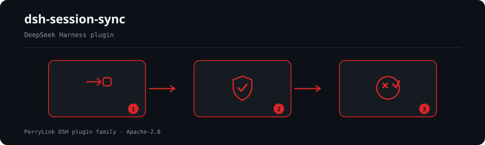

<div align="center">

# 🔄 dsh-session-sync
- **Canal 1024 store**: `npm i -g dsh1024` una vez, luego `dsh1024 plugin --profile web add dsh-session-sync` (cuenta para el ranking de instalaciones de [deepseek1024.com](https://deepseek1024.com)).

**Sincronización de sesiones entre dispositivos para DeepSeek Harness — un espejo git dedicado de tu almacén de sesiones.**

*Sincroniza tus sesiones entre dispositivos, conserva ambos lados ante cualquier conflicto, nunca pierdas un turno.*

[](LICENSE)
[](https://gitee.com/perrylink/dsh-session-sync)
[](https://github.com/topics/dsh-plugin)
[](https://github.com/PerryLink/dsh-plugin-doctor#verified-徽章)
[](https://dsh.market/)
[](#)
[](https://github.com/PerryLink/dsh-session-sync/actions)
[](https://github.com/PerryLink/dsh-session-sync/releases)
[](https://www.npmjs.com/package/dsh-session-sync)
[](https://www.npmjs.com/package/dsh-session-sync)
[](https://dshfind.com/es/plugins/PerryLink/dsh-session-sync?ref=badge)

[English](README.md) · [简体中文](README-zh.md) · [Español](README-es.md) · [Português](README-pt.md) · [हिन्दी](README-hi.md)

```sh
dsh plugin --profile <name> add dsh-session-sync
```


</div>

---


**📖 Base de conocimiento del ecosistema** — datos medidos, no marketing: [guía de desarrollo · datos de selección · criterios de mantenimiento](https://perrylink.github.io/dsh-plugin-guide/).

<!-- star-cta -->
## Instalación y desinstalación

- **Canal git** (último `main`): `dsh plugin --profile web add github:PerryLink/dsh-session-sync` (equivalente a instalar desde `git+https://github.com/PerryLink/dsh-session-sync.git`). Sin paso de compilación — `index.mjs` y `lib/` son los artefactos publicados.
- **Canal npm** (versiones publicadas): `dsh plugin --profile web add dsh-session-sync`.
- **Canal tarball**: `pnpm pack` en este repositorio, luego `dsh plugin --profile web add ./dsh-session-sync-<version>.tgz`.
- **Desinstalar**: `dsh plugin --profile web remove dsh-session-sync` (o elimina la fila del parche de perfil).

## ⭐ 如果它帮到了你

Este plugin forma parte de la [familia de plugins DSH](https://github.com/PerryLink) (más de 40, todos Apache-2.0). Si te resulta útil, **dale una estrella**: no desbloquea nada, pero ayuda a que la siguiente persona lo encuentre antes.

*English:* part of a 95 plugin family for DeepSeek Harness. If it is useful, **a star helps the next person find it** — nothing is gated behind it.

## What is dsh-session-sync?

Sincronización de sesiones entre dispositivos para DeepSeek Harness — un espejo git dedicado de tu almacén de sesiones.

Sincroniza tus sesiones entre dispositivos, conserva ambos lados ante cualquier conflicto, nunca pierdas un turno.



*Resumen del flujo: solicitud → política/revisión → veredicto. Los ejemplos siguientes usan la superficie de comandos real.*


*La misma ejecución, animada.*

## Compatibilidad

| Superficie | Estado |
|---|---|
| Harness | DeepSeek Harness `dsh-v0.2.1-alpha.1` (tag de GitHub, verificado el 2026-09-25: cadena completa de puertas contra los peers `0.1.7-rc.2` fijados). Línea de dependencias npm `0.1.7-rc.2`, peers `>=0.1.2-rc.1 <0.2.0 || >=0.1.5-alpha.1 <0.2.0 || >=0.1.6-0 <0.2.0 || >=0.1.7-0 <0.2.0`. (adaptado el 2026-10-04): el aviso de fork por conflicto lleva el source kind propio del plugin (producer-owned) - el harness retiró el kind compartido `plugin` y lo rechaza al releer. |
| Node | `^22.19.0 \|\| >=24.0.0` |
| Plataformas | Cualquier lugar donde `git` y DSH se ejecuten (espejo basado en git; sin código específico de plataforma) |
| Modelo | Los modelos solo texto funcionan plenamente; no se requiere visión ni capacidad extra |

## Qué obtienes

`dsh-session-sync` refleja tu almacén de sesiones de DSH en un árbol de trabajo git dedicado y lo sincroniza con un remoto que **tú** controlas — sin servicio en la nube, sin almacenamiento de terceros:

- **Comando `/sync`** — `status` (rama, remoto saneado, delante/detrás, archivos sucios, forks), `diff`, `log`, `pull`, `push`, `help`.
- **Herramientas `sync_status` / `sync_pull` / `sync_push`** — la misma superficie para el modelo, dentro de un turno.
- **Resolución de conflictos append-only** — los registros de sesión son append-only; ante cualquier divergencia el plugin conserva **ambos** lados (la versión local se conserva, la remota se preserva como archivos fork) y nunca sobrescribe en silencio. Las sesiones divergentes también pueden bifurcarse a nivel de sesión.
- **Modos automáticos** — pull al iniciar, push tras cada turno cerrado y pull periódico, todos configurables y reversibles.
- **Escrituras con confirmación** — `pull`/`push` preguntan primero (mediante `userQuestions` o `approval`); las superficies de solo lectura nunca preguntan; sin respondedor la operación falla cerrada.

```text
dispositivo A                         remoto (tu repositorio git)              dispositivo B
$DSH_HOME/sessions ──espejo──▶ commit ──push──▶ [sessions] ──pull──▶ merge (conservar ambos + fork)
```

## Inicio rápido

```sh
dsh plugin --profile web add github:PerryLink/dsh-session-sync
```

```sh
# 1. instala el bundle en tu perfil
dsh plugin --profile web add github:PerryLink/dsh-session-sync

# o desde npm (versiones publicadas)
dsh plugin --profile web add dsh-session-sync

# 2. apúntalo a un remoto git privado y verifica la fila
dsh --profile web --dump-config | grep -A2 'id: session-sync'
```

Luego configura el remoto en tu parche de perfil (un repositorio **privado** es la base) y sincroniza:

```yaml
- insert:
    - id: session-sync
      name: dsh-session-sync
      config:
        remote: git@github.com:you/your-dsh-sessions.git
```

```
> /sync status
> /sync pull
> /sync push
```

### Ejemplos

Son los puntos de entrada reales; instala y llama a uno.

#### Ejemplo detallado

**Comando**

~~~sh
/sync help
~~~

**Salida**

~~~text
sync: usage — /sync [status | pull | push | diff | log | help]
  status  show mirror state (default): branch, remote, ahead/behind, dirty, forks
  pull    fetch + merge remote changes (keep-both; confirms first)
  push    mirror + commit + push local changes (confirms first)
  diff    uncommitted changes + HEAD..remote stat (read-only)
  log     last commits in the sync repository
~~~

*Observado en `index.mjs:754-765 (registered /sync handler)`*

#### Ejemplos breves

- `/sync diff`
- `/sync pull`

## Configuración

Todos los ajustes son campos de `Config` de Schemastery (modificables desde cordis.yml). Una sobrescritura dirigida por id reemplaza toda la fila — repite cada clave que necesites. `cordis.patch.yml` documenta cada clave en línea.

| Clave | Valor predeterminado | Significado |
|---|---|---|
| `enabled` | `true` | Interruptor maestro; `false` desregistra el comando, las herramientas, los oyentes y los modos automáticos |
| `backend` | `git` | Backend de sincronización: `git` (espejo en texto plano) o `encrypted` (contenido del espejo cifrado con age) |
| `sessionRoot` | `''` | Raíz del almacén de sesiones; vacío = `$DSH_HOME/sessions` (si faltan ambos, falla la carga) |
| `repoDir` | `''` | Raíz del árbol de trabajo; vacío = `$DSH_HOME/dsh-session-sync/repo` |
| `remote` | `''` | Dirección remota (requerida antes de pull/push; status/diff funcionan sin ella) |
| `branch` | `main` | Nombre de la rama remota |
| `gitBin` | `git` | Ruta del ejecutable git |
| `ageBin` | `age` | Ruta del ejecutable age (se sondea con `backend: encrypted`; si falta, degrada a texto plano) |
| `ageRecipient` | `''` | Destinatario age (clave pública o cadena de identidad); vacío = no se puede cifrar, degrada a texto plano |
| `ageIdentity` | `''` | Ruta a una clave secreta age sin frase de paso (para descifrar); vacío = degrada a texto plano |
| `autoPullOnStart` | `false` | Hace pull una vez al montar el plugin (la configuración es la concesión; sin reconfirmar) |
| `autoPushOnTurnEnd` | `false` | Hace push tras cada turno cerrado |
| `pullIntervalMinutes` | `0` | Pull periódico cada N minutos (`0` = apagado, máx. `10080`) |
| `confirmVia` | `auto` | Canal de confirmación: `auto` (primero userQuestions, luego approval), `userQuestions`, `approval` |
| `graceMs` | `10000` | Periodo de gracia para matar git (ms) |
| `commandTimeoutMs` | `120000` | Tiempo de espera por comando (ms) |
| `maxOutputBytes` | `262144` | Límite de salida recolectada por flujo (bytes) |
| `commitName` | `dsh-session-sync` | Nombre del autor del commit |
| `commitEmail` | `dsh-session-sync@localhost` | Correo del autor del commit |
| `registerCommand` | `true` | Registra el comando `/sync` |
| `registerTools` | `true` | Registra las herramientas `sync_*` cuando el servicio tools está presente |

Ejemplo de sobrescritura en tu parche de perfil:

```yaml
- insert:
    - id: session-sync
      name: dsh-session-sync
      config:
        remote: git@github.com:you/your-dsh-sessions.git
        branch: main
        autoPushOnTurnEnd: true
        pullIntervalMinutes: 30
        confirmVia: userQuestions
```

## Herramientas y superficies

| Superficie | Solo lectura | Requiere confirmación | Notas |
|---|---|---|---|
| `/sync status` | ✅ | — | Rama, remoto saneado, delante/detrás, archivos sucios, archivos fork, último pull/push |
| `/sync diff` | ✅ | — | Cambios sin commit + estadística `HEAD..remote` (solo lectura) |
| `/sync log` | ✅ | — | Últimos commits del repositorio de sincronización |
| `/sync pull` | | ✅ | Fetch + merge con semántica de conservar ambos; lo local se conserva, lo remoto se preserva como forks |
| `/sync push` | | ✅ | Espejo + commit + push; nunca fuerza push, reconcilia y reintenta una vez ante rechazo |
| `sync_status` | ✅ | — | Los mismos datos que `/sync status` para el modelo |
| `sync_pull` | | ✅ | Pull invocable por el modelo |
| `sync_push` | | ✅ | Push invocable por el modelo |

## Permisos y datos

- **Permisos**: las operaciones mutadoras cruzan la puerta de confirmación (`confirmVia`); el plugin nunca reimplementa ni elude los servicios `userQuestions`/`approval` del harness. Los modos automáticos están cubiertos por la concesión de configuración y nunca reconfirman.
- **Datos**: los metadatos de sincronización (id de dispositivo, último pull/push, última cabecera de push, último error) viven en el dominio de almacenamiento `session-sync`. Los archivos de sesión se copian como bytes opacos — el plugin nunca los analiza. El id de dispositivo también se escribe en `device.txt` en el repositorio de sincronización para la atribución de forks entre dispositivos.
- **Registro de sesión**: `sync/push`, `sync/pull` y `sync/conflict` están declarados en `types.d.ts`; se anexan solo cuando el host registra los tipos (ver Limitaciones conocidas). Todo lo escrito o mostrado se sanea. El único mensaje duradero que el plugin escribe —el aviso de fork por conflicto— lleva el source kind propio del plugin (producer-owned, `dsh-session-sync`); el harness retiró el kind compartido `plugin` y lo rechaza al releer una sesión.

## Límites de seguridad

- **Nunca sobrescribe en silencio.** El merge de tres vías append-only conserva ambos lados ante cualquier divergencia; los archivos fork nunca se eliminan y git nunca fuerza push, resetea, rebase ni cambia de rama.
- **Contención de rutas.** Los archivos se reflejan como bytes opacos con enlaces simbólicos rechazados y cada ruta unida se comprueba por contención (`PATH_UNSAFE` falla alto).
- **Salida saneada.** Las credenciales de URL remota, los tokens y los secretos `key=value` se redactan antes de llegar al modelo o al registro; la visualización de rutas rechaza todo lo que esté fuera de su raíz.
- **Sin almacenamiento de credenciales.** El plugin no almacena credenciales; las credenciales de git viven en tu helper de credenciales normal. Las identidades/destinatarios age los gestionas tú, y las claves nunca entran en el repositorio de sincronización.
- **Endurecimiento de git.** git se ejecuta con `GIT_TERMINAL_PROMPT=0` y `GIT_OPTIONAL_LOCKS=0`, acotado por plazo y señal, con un límite de salida por flujo.
- **Falla cerrada.** La falta de respondedor de confirmación, de remoto o una ruta insegura rechaza la operación alto.

## Cifrado y modelo de amenazas

`backend: encrypted` añade una capa **age** opcional sobre el espejo: los bytes de sesión se cifran en archivos `encrypted/**/*.age` antes de commitear y subir, y se descifran de vuelta al espejo local en texto plano antes de fusionar. La fusión a tres bandas siempre se ejecuta en texto plano localmente, por lo que la semántica append-only de conservar ambos lados no cambia.

Qué **protege** el cifrado:

- **El contenido del espejo en reposo en el remoto.** Los archivos de sesión que subes son texto cifrado age; el host remoto, sus operadores y cualquiera que clone el repositorio no ven los bytes de sesión en claro sin la clave privada.

Qué **no** protege (la frontera):

- **Las claves e identidades age son tuyas.** Los archivos de destinatario/identidad nunca son distribuidos, almacenados ni rotados por el plugin. Si una clave se filtra, el contenido del espejo que protege queda expuesto. Usa una identidad sin frase de contraseña y mantenla fuera del repositorio.
- **El remoto sigue siendo en la práctica un repositorio privado.** Los metadatos de git — mensajes de commit, el `.gitignore`, la estructura de rutas `encrypted/`, los nombres de rama y la actividad de push/fetch — siguen siendo visibles para el host remoto. El cifrado oculta el *contenido*, no el hecho de que sincronizas, ni la forma de tu árbol de sesiones.
- **El texto plano sigue existiendo localmente.** El espejo en `<repoDir>/sessions/` es texto plano en disco; el cifrado protege la copia transmitida/remota, no el cifrado del disco local ni el almacén de sesiones en vivo.
- **La degradación elegante significa texto plano.** Con `backend: encrypted`, si falta `age`, o `ageRecipient`/`ageIdentity` están vacíos, el plugin cae al camino git en texto plano **y avisa explícitamente** en el estado/registro — nunca finge cifrar. Revisa la advertencia en `/sync status` antes de confiar en el remoto como cifrado.

Línea base: con `backend: git` (el predeterminado), los bytes de sesión se almacenan sin cifrar en **tu** remoto git — usa un repositorio privado.

## Limitaciones conocidas

- **El cifrado es opcional.** `backend: encrypted` añade una capa age (ver «Cifrado y modelo de amenazas» arriba); si falta `age` o las claves, cae a texto plano con una advertencia explícita. Con `backend: git` (el predeterminado), los bytes de sesión se almacenan sin cifrar en **tu** remoto git — usa un repositorio privado.
- **Se requiere git.** El plugin necesita el ejecutable `git` y el servicio `subprocess`; sin ellos, las operaciones de sincronización fallan con un motivo claro (los perfiles siguen arrancando).
- **Eventos de sesión en `0.1.0-rc.6`/`0.1.0-rc.8`/`0.1.1-rc.2`/`0.1.2-alpha.2`/`0.1.2-alpha.3`/`0.1.2-rc.1`/`0.1.7-alpha.2`.** El harness aún no registra los tipos `sync/*`, por lo que los anexos al registro de sesión se omiten (las sesiones siguen cargando); el plugin los habilita automáticamente una vez que un host registra los tipos o expone el envoltorio `ignorable` en `Session.append`.
- **`approval` entre turnos.** `/sync` se ejecuta entre turnos, donde el canal `approval` no tiene un turno abierto al que adjuntarse; usa `confirmVia: userQuestions` para la sincronización por comando, o impulsa la sincronización mediante las herramientas dentro de un turno. La comprobación de turno abierto lee la proyección de sesión `turnBoundary` del host: una composición sin `@deepseek-ai/dsh-session-projection` no puede verificar el estado del turno y falla en cerrado con ese motivo.
- **Los artefactos privados del host no se sincronizan.** `session.lock` (el arriendo de sesión del harness) y los archivos de staging `session.migration.*.tmp` nunca se reflejan ni se eliminan: son estado de ejecución, no contenido sincronizable. Los registros de sesión (`session.jsonl`, `session.v[1-9]*.jsonl[.zstd]`) siguen siendo la carga útil reflejada.

## Desarrollo

```sh
pnpm install                                       # node ^22.19 || >=24
pnpm run typecheck && pnpm run typecheck:ci        # tsc --checkJs contra los peers 0.1.7-alpha.2 publicados
pnpm test                                          # node --test (13 archivos de test; la suite git del motor se omite sin git)
pnpm run verify:self-contained                     # las specs de dependencias resuelven desde el registro
pnpm run verify:artifacts                          # archivos publicados presentes + index.mjs importable
pnpm run check:readmes                             # consistencia de los cinco README
pnpm pack                                          # el tarball publicado
```

No hay paso de compilación: ESM puro, `index.mjs` y `lib/` son los artefactos publicados.

## Topics

`dsh`, `dsh-plugin`, `deepseek-harness`, `deepseek`, `cordis`, `session-sync`, `session`, `git`, `sync`, `cross-device`

## Contribuyentes

- [@PerryLink](https://github.com/PerryLink) — creador y mantenedor: motor de espejo git, merge append-only conservando ambos, comando `/sync` y herramientas `sync_*`, modos automáticos, saneadores y documentación en cinco idiomas.

## PerryLink DSH Plugin Family

Este proyecto forma parte de la familia de plugins de DeepSeek Harness de [PerryLink](https://github.com/PerryLink). El registro permanece plegado abajo para que cada README conserve una primera pantalla corta; expándelo para ver cada fila y su estado.

<details>
<summary>Expandir todos los plugins</summary>

| Plugin | Estado |
|---|---|
| **[dsh-aqua-input-check](https://github.com/PerryLink/dsh-aqua-input-check)** |  |
| **[dsh-archive-check](https://github.com/PerryLink/dsh-archive-check)** |  |
| **[dsh-auto-review](https://github.com/PerryLink/dsh-auto-review)** |  |
| **[dsh-autotier](https://github.com/PerryLink/dsh-autotier)** |  |
| **[dsh-bid-ca-precheck](https://github.com/PerryLink/dsh-bid-ca-precheck)** |  |
| **[dsh-bid-qual-check](https://github.com/PerryLink/dsh-bid-qual-check)** |  |
| **[dsh-cert-mcp](https://github.com/PerryLink/dsh-cert-mcp)** |  |
| **[dsh-checkpoint-rewind](https://github.com/PerryLink/dsh-checkpoint-rewind)** |  |
| **[dsh-click](https://github.com/PerryLink/dsh-click)** |  |
| **[dsh-composer-history](https://github.com/PerryLink/dsh-composer-history)** |  |
| **[dsh-contract-stance](https://github.com/PerryLink/dsh-contract-stance)** |  |
| **[dsh-customs-doc-check](https://github.com/PerryLink/dsh-customs-doc-check)** |  |
| **[dsh-data-quality](https://github.com/PerryLink/dsh-data-quality)** |  |
| **[dsh-demurrage-ledger](https://github.com/PerryLink/dsh-demurrage-ledger)** |  |
| **[dsh-doublecheck](https://github.com/PerryLink/dsh-doublecheck)** |  |
| **[dsh-drill-script-check](https://github.com/PerryLink/dsh-drill-script-check)** |  |
| **[dsh-eia-guide-check](https://github.com/PerryLink/dsh-eia-guide-check)** |  |
| **[dsh-emergency-plan](https://github.com/PerryLink/dsh-emergency-plan)** |  |
| **[dsh-essay-rubric-check](https://github.com/PerryLink/dsh-essay-rubric-check)** |  |
| **[dsh-evidence-check](https://github.com/PerryLink/dsh-evidence-check)** |  |
| **[dsh-export-ctl-check](https://github.com/PerryLink/dsh-export-ctl-check)** |  |
| **[dsh-fast](https://github.com/PerryLink/dsh-fast)** |  |
| **[dsh-fmea-table-check](https://github.com/PerryLink/dsh-fmea-table-check)** |  |
| **[dsh-forecast-penalty](https://github.com/PerryLink/dsh-forecast-penalty)** |  |
| **[dsh-fund-research](https://github.com/PerryLink/dsh-fund-research)** |  |
| **[dsh-github](https://github.com/PerryLink/dsh-github)** |  |
| **[dsh-gongwen-flow-check](https://github.com/PerryLink/dsh-gongwen-flow-check)** |  |
| **[dsh-gongwen-word-check](https://github.com/PerryLink/dsh-gongwen-word-check)** |  |
| **[dsh-guard-plan-qc](https://github.com/PerryLink/dsh-guard-plan-qc)** |  |
| **[dsh-hazchem-check](https://github.com/PerryLink/dsh-hazchem-check)** |  |
| **[dsh-hazplan-check](https://github.com/PerryLink/dsh-hazplan-check)** |  |
| **[dsh-hidden-risk-map](https://github.com/PerryLink/dsh-hidden-risk-map)** |  |
| **[dsh-hs-classify](https://github.com/PerryLink/dsh-hs-classify)** |  |
| **[dsh-icd-rule-check](https://github.com/PerryLink/dsh-icd-rule-check)** |  |
| **[dsh-industry-research](https://github.com/PerryLink/dsh-industry-research)** |  |
| **[dsh-lawcite-adapter](https://github.com/PerryLink/dsh-lawcite-adapter)** |  |
| **[dsh-laya](https://github.com/PerryLink/dsh-laya)** |  |
| **[dsh-lc-doc-check](https://github.com/PerryLink/dsh-lc-doc-check)** |  |
| **[dsh-learning-gap-check](https://github.com/PerryLink/dsh-learning-gap-check)** |  |
| **[dsh-library](https://github.com/PerryLink/dsh-library)** |  |
| **[dsh-local-ai](https://github.com/PerryLink/dsh-local-ai)** |  |
| **[dsh-lsp-actions](https://github.com/PerryLink/dsh-lsp-actions)** |  |
| **[dsh-mask](https://github.com/PerryLink/dsh-mask)** |  |
| **[dsh-mcp-panel](https://github.com/PerryLink/dsh-mcp-panel)** |  |
| **[dsh-medrec-qc](https://github.com/PerryLink/dsh-medrec-qc)** |  |
| **[dsh-memento](https://github.com/PerryLink/dsh-memento)** |  |
| **[dsh-nsfc-form-check](https://github.com/PerryLink/dsh-nsfc-form-check)** |  |
| **[dsh-nurse-record-check](https://github.com/PerryLink/dsh-nurse-record-check)** |  |
| **[dsh-observe](https://github.com/PerryLink/dsh-observe)** |  |
| **[dsh-origin-rvc-check](https://github.com/PerryLink/dsh-origin-rvc-check)** |  |
| **[dsh-ota-review-check](https://github.com/PerryLink/dsh-ota-review-check)** |  |
| **[dsh-output-styles](https://github.com/PerryLink/dsh-output-styles)** |  |
| **[dsh-paper-doc-adapter](https://github.com/PerryLink/dsh-paper-doc-adapter)** |  |
| **[dsh-permission-rules](https://github.com/PerryLink/dsh-permission-rules)** |  |
| **[dsh-permit-report-check](https://github.com/PerryLink/dsh-permit-report-check)** |  |
| **[dsh-pipeline-check](https://github.com/PerryLink/dsh-pipeline-check)** |  |
| **[dsh-pleading-draft](https://github.com/PerryLink/dsh-pleading-draft)** |  |
| **[dsh-plugin-doctor](https://github.com/PerryLink/dsh-plugin-doctor)** |  |
| **[dsh-plugin-guide](https://github.com/PerryLink/dsh-plugin-guide)** |  |
| **[dsh-plugin-kit](https://github.com/PerryLink/dsh-plugin-kit)** |  |
| **[dsh-plugin-upgrade](https://github.com/PerryLink/dsh-plugin-upgrade)** |  |
| **[dsh-policy-brief-draft](https://github.com/PerryLink/dsh-policy-brief-draft)** |  |
| **[dsh-power-loss-split](https://github.com/PerryLink/dsh-power-loss-split)** |  |
| **[dsh-power-ticket-check](https://github.com/PerryLink/dsh-power-ticket-check)** |  |
| **[dsh-ppap-check](https://github.com/PerryLink/dsh-ppap-check)** |  |
| **[dsh-protest-deadline](https://github.com/PerryLink/dsh-protest-deadline)** |  |
| **[dsh-railway-window](https://github.com/PerryLink/dsh-railway-window)** |  |
| **[dsh-repair-order-qc](https://github.com/PerryLink/dsh-repair-order-qc)** |  |
| **[dsh-research-report](https://github.com/PerryLink/dsh-research-report)** |  |
| **[dsh-review-reply-check](https://github.com/PerryLink/dsh-review-reply-check)** |  |
| **[dsh-rulefile-check](https://github.com/PerryLink/dsh-rulefile-check)** |  |
| **[dsh-safety-brief-check](https://github.com/PerryLink/dsh-safety-brief-check)** |  |
| **[dsh-score](https://github.com/PerryLink/dsh-score)** |  |
| **[dsh-session-sync](https://github.com/PerryLink/dsh-session-sync)** |  |
| **[dsh-site-log-check](https://github.com/PerryLink/dsh-site-log-check)** |  |
| **[dsh-skill-pack-security](https://github.com/PerryLink/dsh-skill-pack-security)** |  |
| **[dsh-soe-decision-check](https://github.com/PerryLink/dsh-soe-decision-check)** |  |
| **[dsh-soilwater-check](https://github.com/PerryLink/dsh-soilwater-check)** |  |
| **[dsh-sop-sync-check](https://github.com/PerryLink/dsh-sop-sync-check)** |  |
| **[dsh-spc-gbt-adapter](https://github.com/PerryLink/dsh-spc-gbt-adapter)** |  |
| **[dsh-talk](https://github.com/PerryLink/dsh-talk)** |  |
| **[dsh-tender-extract](https://github.com/PerryLink/dsh-tender-extract)** |  |
| **[dsh-tender-matrix](https://github.com/PerryLink/dsh-tender-matrix)** |  |
| **[dsh-test-drive](https://github.com/PerryLink/dsh-test-drive)** |  |
| **[dsh-ticktick](https://github.com/PerryLink/dsh-ticktick)** |  |
| **[dsh-translate](https://github.com/PerryLink/dsh-translate)** |  |
| **[dsh-warranty-calc](https://github.com/PerryLink/dsh-warranty-calc)** |  |
| **[dsh-budget](https://github.com/PerryLink/dsh-budget)** | 🧊 CONGELADO — ver el README del repositorio |
| **[dsh-claude-move](https://github.com/PerryLink/dsh-claude-move)** | 🧊 CONGELADO — ver el README del repositorio |
| **[dsh-defend](https://github.com/PerryLink/dsh-defend)** | 🧊 CONGELADO — ver el README del repositorio |
| **[dsh-draw](https://github.com/PerryLink/dsh-draw)** | 🧊 CONGELADO — ver el README del repositorio |
| **[dsh-reach](https://github.com/PerryLink/dsh-reach)** | 🧊 CONGELADO — ver el README del repositorio |
| **[dsh-background-agents](https://github.com/PerryLink/dsh-background-agents)** | 🚫 RETIRADO — ver el README del repositorio |
| **[dsh-session-pin](https://github.com/PerryLink/dsh-session-pin)** | 🚫 RETIRADO — ver el README del repositorio |
| **[dsh-team-rooms](https://github.com/PerryLink/dsh-team-rooms)** | 🚫 RETIRADO — ver el README del repositorio |

</details>

## Licencia

[LICENSE](LICENSE) (Apache License 2.0) © 2026 dsh-session-sync contributors
