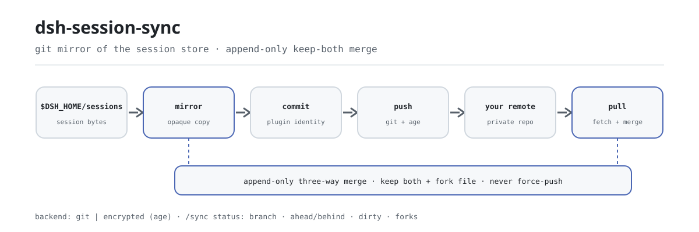

<div align="center">

<picture>
  <source media="(prefers-color-scheme: dark)" srcset="docs/assets/dsh-session-sync-flow-dark.svg">
  
</picture>

# dsh-session-sync

**Mirror your session store into a git repository you control — sync across devices, keep both sides on conflict, never lose a turn.**

A pure host-side sync plugin for DeepSeek Harness: session files are copied as opaque bytes, divergence is resolved by an append-only three-way merge, and the remote is yours (plaintext git by default, optional age encryption) — no cloud service, no third-party storage.

[Install](#three-step-setup) · [Configuration](#configuration) · [FAQ](#faq) · [简体中文](README.md) · [English](README.en.md) · [Español](README.es.md) · [Português](README.pt.md) · [हिन्दी](README.hi.md)

[](LICENSE)
[](#compatibility)
[](https://www.npmjs.com/package/dsh-session-sync)
[](https://github.com/PerryLink/dsh-session-sync/actions/workflows/ci.yml)
[](#compatibility)

[](https://github.com/PerryLink/dsh-session-sync/stargazers)
[](https://www.npmjs.com/package/dsh-session-sync)
[](https://dshfind.com/plugins/PerryLink/dsh-session-sync?ref=badge)
[](https://securityscorecards.dev/viewer/?uri=github.com/PerryLink/dsh-session-sync)
[](https://dsh.market/)
[](https://gitee.com/perrylink/dsh-session-sync)

```sh
dsh plugin --profile <name> add dsh-session-sync
```

</div>

<sub>Community plugin, not affiliated with DeepSeek. This is the only official repository, maintained by PerryLink; same-name repositories under other accounts are not affiliated. Gitee is a mirror.</sub>

## What it is

`dsh-session-sync` mirrors the DSH session store (`$DSH_HOME/sessions`) into a dedicated git worktree and syncs it to a remote **you** control: no cloud service, no third-party storage. Session files are copied as opaque bytes — the plugin never parses JSONL/zstd, since the physical encoding belongs to the harness; its job is to move those bytes, merge append-only histories, and report state. On any divergence it runs an append-only three-way merge: **both sides are kept**, the remote version is preserved as fork files, and nothing is silently overwritten. `backend: git` (the default) is a plaintext mirror; `backend: encrypted` adds an age layer above it; every auto mode is configurable and reversible.

## Three-step setup

1. **Install** (pick one channel):

   ```sh
   # git channel (latest main; equivalent to git+https://github.com/PerryLink/dsh-session-sync.git)
   dsh plugin --profile web add github:PerryLink/dsh-session-sync
   # npm channel (published releases)
   dsh plugin --profile web add dsh-session-sync
   # tarball channel: pnpm pack in this repo, then
   dsh plugin --profile web add ./dsh-session-sync-<version>.tgz
   ```

   No build step — `index.mjs` and `lib/` are the shipped artifacts.

2. **Minimal config** (point it at a **private** git remote in your profile patch):

   ```yaml
   - insert:
       - id: session-sync
         name: dsh-session-sync
         config:
           remote: git@github.com:you/your-dsh-sessions.git
   ```

3. **Verify it mounts**:

   ```sh
   dsh --profile web --dump-config | grep -A2 'id: session-sync'
   ```

   ```
   > /sync status
   > /sync pull
   > /sync push
   ```

**Uninstall**: `dsh plugin --profile web remove dsh-session-sync` (or remove the row from the profile patch).

## Core capabilities

`dsh-session-sync` turns the session store into a versioned git mirror on the host and hands the sync action to your remote:

- **`/sync` command** — `status` (branch, sanitized remote, ahead/behind, dirty files, forks), `diff`, `log`, `pull`, `push`, `help`.
- **`sync_status` / `sync_pull` / `sync_push` tools** — the same surface for the model, inside a turn.
- **Append-only conflict resolution** — session logs are append-only; on any divergence the plugin keeps **both** sides (local version kept, remote version preserved as fork files) and never silently overwrites. Diverged sessions can also fork at the session level.
- **Auto modes** — pull on start, push after every closed turn, and periodic pull, all configurable and all reversible.
- **Confirmation-gated writes** — `pull`/`push` ask first (through `userQuestions` or `approval`); read-only surfaces never ask; with no answerer the operation fails closed.

```text
device A                              remote (your git repo)                  device B
$DSH_HOME/sessions ──mirror──▶ commit ──push──▶ [sessions] ──pull──▶ merge (keep-both + fork)
```

### Commands & tools surface

| Surface | Read-only | Needs confirmation | Notes |
|---|---|---|---|
| `/sync status` | ✅ | — | Branch, sanitized remote, ahead/behind, dirty files, fork files, last pull/push |
| `/sync diff` | ✅ | — | Uncommitted changes + `HEAD..remote` stat (read-only) |
| `/sync log` | ✅ | — | Last commits in the sync repository |
| `/sync pull` | | ✅ | Fetch + merge with keep-both semantics; local kept, remote preserved as forks |
| `/sync push` | | ✅ | Mirror + commit + push; never force-pushes, reconciles and retries once on rejection |
| `sync_status` | ✅ | — | Same facts as `/sync status` for the model |
| `sync_pull` | | ✅ | Model-callable pull |
| `sync_push` | | ✅ | Model-callable push |

### Examples

These are the plugin's real entry points; install once, then call one.

**Detailed example** — command `/sync help`:

```text
sync: usage — /sync [status | pull | push | diff | log | help]
  status  show mirror state (default): branch, remote, ahead/behind, dirty, forks
  pull    fetch + merge remote changes (keep-both; confirms first)
  push    mirror + commit + push local changes (confirms first)
  diff    uncommitted changes + HEAD..remote stat (read-only)
  log     last commits in the sync repository
```

*Observed from `index.mjs:754-765 (registered /sync handler)`*

**Failure branch** — input `/sync push`:

```text
sync: cancelled: approval requires an open turn; /sync commands run between turns — mount userQuestions or set confirmVia: userQuestions
```

*Observed from `plugins/dsh-session-sync/lib/gate.mjs:134-137; plugins/dsh-session-sync/index.mjs:792-794; plugins/dsh-session-sync/test/gate.test.mjs:80-88; plugins/dsh-session-sync/README.md:246`*

**Brief examples**: `/sync diff` · `/sync pull`

## Configuration

All tunables are Schemastery `Config` fields (changeable from cordis.yml). An id-targeted override replaces the whole row — restate every key you need. `cordis.patch.yml` documents each key inline.

Most-used keys:

| Key | Default | Meaning |
|---|---|---|
| `remote` | `''` | Remote address (required before pull/push; status/diff work without one) |
| `backend` | `git` | Sync backend: `git` (plaintext mirror) or `encrypted` (age-encrypted mirror content) |
| `sessionRoot` | `''` | Session store root; empty = `$DSH_HOME/sessions` (both missing fails load) |
| `repoDir` | `''` | Sync worktree root; empty = `$DSH_HOME/dsh-session-sync/repo` |
| `branch` | `main` | Remote branch name |
| `autoPushOnTurnEnd` | `false` | Push after every closed turn |
| `pullIntervalMinutes` | `0` | Periodic pull every N minutes (`0` = off, max `10080`) |
| `confirmVia` | `auto` | Confirmation channel: `auto` (userQuestions first, then approval), `userQuestions`, `approval` |

<details>
<summary>Full configuration table (21 keys)</summary>

| Key | Default | Meaning |
|---|---|---|
| `enabled` | `true` | Master switch; `false` unregisters the command, tools, listeners, and auto modes |
| `backend` | `git` | Sync backend: `git` (plaintext mirror) or `encrypted` (age-encrypted mirror content) |
| `sessionRoot` | `''` | Session store root; empty = `$DSH_HOME/sessions` (both missing fails load) |
| `repoDir` | `''` | Sync worktree root; empty = `$DSH_HOME/dsh-session-sync/repo` |
| `remote` | `''` | Remote address (required before pull/push; status/diff work without one) |
| `branch` | `main` | Remote branch name |
| `gitBin` | `git` | git executable path |
| `ageBin` | `age` | age executable path (probed for `backend: encrypted`; missing degrades to plaintext) |
| `ageRecipient` | `''` | age recipient (public key or identity string); empty = cannot encrypt, degrades to plaintext |
| `ageIdentity` | `''` | Path to a passphrase-less age secret key for decryption; empty = cannot decrypt, degrades to plaintext |
| `autoPullOnStart` | `false` | Pull once when the plugin mounts (config is the grant; no re-confirm) |
| `autoPushOnTurnEnd` | `false` | Push after every closed turn |
| `pullIntervalMinutes` | `0` | Periodic pull every N minutes (`0` = off, max `10080`) |
| `confirmVia` | `auto` | Confirmation channel: `auto` (userQuestions first, then approval), `userQuestions`, `approval` |
| `graceMs` | `10000` | Grace period for git kills (ms) |
| `commandTimeoutMs` | `120000` | Per-command timeout (ms) |
| `maxOutputBytes` | `262144` | Per-stream collected-output cap (bytes) |
| `commitName` | `dsh-session-sync` | Commit author name |
| `commitEmail` | `dsh-session-sync@localhost` | Commit author email |
| `registerCommand` | `true` | Register the `/sync` command |
| `registerTools` | `true` | Register the `sync_*` tools when the tools service is present |

</details>

Example override in your profile patch:

```yaml
- insert:
    - id: session-sync
      name: dsh-session-sync
      config:
        remote: git@github.com:you/your-dsh-sessions.git
        branch: main
        autoPushOnTurnEnd: true
        pullIntervalMinutes: 30
        confirmVia: userQuestions
```

## FAQ

<details>
<summary>Where does the data actually live? Is anything uploaded to a cloud?</summary>

No cloud service and no third-party storage. Two copies stay on your machine: `$DSH_HOME/sessions` (the harness session store) and the `repoDir` worktree you configure (default `$DSH_HOME/dsh-session-sync/repo`); the remote is **your own** git repository. `backend: encrypted` only turns the pushed/remote copy into age ciphertext — the local mirror stays plaintext.

</details>

<details>
<summary>Can a conflict overwrite or lose a session?</summary>

Nothing is silently overwritten. Session logs are append-only, and the three-way merge keeps both sides on any divergence: the local version is kept and the remote version is preserved as a fork file named `<basename>.remote-fork-<UTC 14-digit stamp>-<device8>`; fork files are never deleted or overwritten, and git never force-pushes, resets, rebases, or switches branches. A diverged session is also forked at the session level, with a persistent notice injected into the child.

</details>

<details>
<summary>Is encryption on by default? What happens when age is missing?</summary>

No — the default is `backend: git`, so session bytes sit unencrypted in your remote: use a private repository. `backend: encrypted` needs `age` plus non-empty `ageRecipient`/`ageIdentity`; if anything is missing the plugin warns explicitly and falls back to plaintext git — it never pretends to encrypt. Check the warning in `/sync status` before treating the remote as encrypted.

</details>

<details>
<summary>What happens without git, or with no confirmation answerer?</summary>

Without the `git` executable or the `subprocess` service, sync operations fail with a clear reason (profiles keep booting). `/sync` runs between turns, where the `approval` channel has no open turn to attach to: use `confirmVia: userQuestions`, or drive sync through the `sync_*` tools inside a turn; with no answerer at all the operation fails closed.

</details>

<details>
<summary>How much overhead is there? Do the auto modes run forever?</summary>

Session files are copied as opaque bytes and never parsed; every git command has a timeout, a kill grace period, and a per-stream output cap. Auto push is off by default, periodic pull is off by default (`pullIntervalMinutes: 0`), and pull-on-start is off by default — once enabled they are covered by the config grant and never re-confirm. Cost depends on session-store size and remote latency; this repository has no benchmark data, so no invented numbers.

</details>

## Security boundaries

- **Never silently overwrite.** The append-only three-way merge keeps both sides on any divergence, including delete/modify (modified bytes kept, deletion intent honored); fork files are never deleted, and git never force-pushes, resets, rebases, or switches branches.
- **Path containment.** Files are mirrored as opaque bytes with symlinks refused and every joined path containment-checked (`PATH_UNSAFE` fails loud).
- **Sanitized output.** Remote-URL credentials, tokens, and `key=value` secrets are redacted before reaching the model or the log; path display refuses anything outside its root.
- **No credential storage.** The plugin stores no credentials; git credentials live in your normal git credential helper. age identities/recipients are yours to manage, and keys never enter the sync repository.
- **Git hardening.** Git runs with `GIT_TERMINAL_PROMPT=0` and `GIT_OPTIONAL_LOCKS=0`, deadline- and signal-bounded, with a per-stream output cap.
- **Fail closed.** A missing confirmation answerer, a missing remote, or an unsafe path refuses the operation loudly.

## Permissions & data

- **Permissions**: mutating operations cross the confirmation gate (`confirmVia`); the plugin never re-implements or bypasses the harness's `userQuestions`/`approval` services. Auto modes are covered by the config grant and never re-confirm.
- **Data**: sync metadata (device id, last pull/push, last push head, last error) lives in the `session-sync` storage domain. Session files are copied as opaque bytes — the plugin never parses them. The device id is also written to `device.txt` in the sync repository for cross-device fork attribution.
- **Session log**: `sync/push`, `sync/pull`, and `sync/conflict` are declared in `types.d.ts`; they are appended only when the host records the types (see Known limitations). Everything written or shown is sanitized. The one durable message the plugin writes — the conflict fork notice — carries the plugin's own producer-owned source kind (`dsh-session-sync`); the harness retired the shared `plugin` kind and refuses it when a session is read back.

## Encryption & threat model

`backend: encrypted` adds an optional **age** layer above the mirror: session bytes are encrypted into `encrypted/**/*.age` files before they are committed and pushed, and decrypted back to the local plaintext mirror before merging. The three-way merge always runs on plaintext locally, so the append-only keep-both semantics are unchanged.

What the encryption **protects**:

- **Mirror content at rest in the remote.** The session files you push are age ciphertext; the remote host, its operators, and anyone who clones the repository do not see plaintext session bytes without the private key.

What it does **not** protect (the boundary):

- **Keys and age identities are yours to manage.** The recipient/identity files are never shipped, stored, or rotated by the plugin. If a key leaks, the mirror content it protects is exposed. Use a passphrase-less identity and keep it out of the repository.
- **The remote is still a private repository in practice.** git metadata — commit messages, the `.gitignore`, the `encrypted/` path structure, branch names, and push/fetch activity — remains visible to the remote host. Encryption hides the *content*, not the fact that you sync, nor the shape of your session tree.
- **Plaintext still exists locally.** The mirror at `<repoDir>/sessions/` is plaintext on disk; encryption protects the transmitted/remote copy, not local disk encryption or the live session store.
- **Graceful degradation means plaintext.** With `backend: encrypted`, if `age` is missing, or `ageRecipient`/`ageIdentity` is empty, the plugin falls back to the plaintext git path **and warns explicitly** in the status/log — it never silently pretends to encrypt. Check `/sync status` for the warning before trusting the remote as encrypted.

Baseline: with `backend: git` (the default), session bytes are stored unencrypted in **your** git remote — use a private repository.

## Known limitations

- **Encryption is optional, and age is an external dependency.** `backend: encrypted` adds an age layer (see "Encryption & threat model" above); a missing `age` or empty `ageRecipient`/`ageIdentity` warns explicitly and degrades to plaintext, and a passphrase-protected identity cannot be used (decryption would block on a TTY prompt, so it fails closed). With `backend: git` (the default), session bytes are stored unencrypted in **your** git remote — use a private repository.
- **`object-storage` is a reserved interface.** It is an interface placeholder and fails loudly at load; only `git` and `encrypted` are implemented.
- **git required.** The plugin needs the `git` executable and the `subprocess` service; without them, sync operations fail with a clear reason (profiles keep booting).
- **One `repoDir` per backend.** Switching between `git` and `encrypted` on the same `repoDir` is not supported; use a fresh worktree per backend.
- **Session events on `0.1.0-rc.6`/`0.1.0-rc.8`/`0.1.1-rc.2`/`0.1.2-alpha.2`/`0.1.2-alpha.3`/`0.1.2-rc.1`/`0.1.7-alpha.2`.** The harness does not record `sync/*` event types, so the session-log appends are skipped (sessions keep loading); the plugin enables them automatically once a host records the types or exposes the `ignorable` envelope on `Session.append`.
- **`approval` between turns.** `/sync` runs between turns, where the `approval` channel has no open turn to attach to; use `confirmVia: userQuestions` for command-driven sync, or drive sync through the tools inside a turn. The open-turn check reads the host `turnBoundary` session projection: a composition without `@deepseek-ai/dsh-session-projection` cannot verify the turn state and fails closed with that reason.
- **Host-private artifacts stay host-private.** `session.lock` (the harness session lease) and `session.migration.*.tmp` staging files are never mirrored or deleted — they are runtime state, not syncable content. Session logs (`session.jsonl`, `session.v[1-9]*.jsonl[.zstd]`) remain the mirrored payload.

## Compatibility

| Surface | Status |
|---|---|
| Harness | DeepSeek Harness `dsh-v0.2.1-alpha.1` (GitHub tag, verified 2026-09-25: full gate chain against the pinned `0.1.7-rc.2` peers). npm dependency line `0.1.7-rc.2`, peers `>=0.1.2-rc.1 <0.2.0 \|\| >=0.1.5-alpha.1 <0.2.0 \|\| >=0.1.6-0 <0.2.0 \|\| >=0.1.7-0 <0.2.0`. (adapted 2026-10-04): the conflict fork notice carries the plugin's own producer-owned message source kind — the harness retired the shared `plugin` kind and refuses it on read-back. |
| Node | `^22.19.0 \|\| >=24.9.0` |
| Platforms | Anywhere `git` and DSH run (git-based mirror; no platform-specific code) |
| Model | Text-only models fully supported; no vision or extra model capability required |

## Ecosystem and quality

- [Gitee mirror](https://gitee.com/perrylink/dsh-session-sync) (synced mirror; GitHub is canonical)
- [dshfind plugin page](https://dshfind.com/plugins/PerryLink/dsh-session-sync) (installs and ranking)
- [OpenSSF Scorecard report](https://securityscorecards.dev/viewer/?uri=github.com/PerryLink/dsh-session-sync) (driven by [.github/workflows/scorecard.yml](.github/workflows/scorecard.yml))
- [dsh-plugin-doctor verification report](https://github.com/PerryLink/dsh-plugin-doctor#verified-徽章) (historical K10–K13 verification badge)
- [DSH Market](https://dsh.market/) (listed)
- **1024 store channel**: run `npm i -g dsh1024` once, then `dsh1024 plugin --profile web add dsh-session-sync` (counts toward the [deepseek1024.com](https://deepseek1024.com) install ranking)
- [Ecosystem knowledge base](https://perrylink.github.io/dsh-plugin-guide/): plugin development guide · measured selection data · maintenance trade-off criteria

## Development

```sh
pnpm install                                       # node ^22.19 || >=24.9
pnpm run typecheck && pnpm run typecheck:ci        # tsc --checkJs: checkout face + published-line face
pnpm test                                          # node --test (14 test files; the engine git suite skips without git)
pnpm run verify:self-contained                     # dependency specs resolve from the registry
pnpm run verify:artifacts                          # shipped files present + index.mjs importable
pnpm run check:readmes                             # five-language README consistency
pnpm pack                                          # the published tarball
```

No build step: pure ESM, `index.mjs` and `lib/` are the shipped artifacts. README images are generated programmatically by [`scripts/gen-readme-assets.py`](scripts/gen-readme-assets.py) (Python + Pillow) and can be re-run safely.

Topics: `dsh`, `dsh-plugin`, `deepseek-harness`, `deepseek`, `cordis`, `session-sync`, `session`, `git`, `sync`, `cross-device`

## Family and thanks

This project is part of the DeepSeek Harness plugin family from [PerryLink](https://github.com/PerryLink) (all Apache-2.0). If it is useful, **a star helps the next person find it** — nothing is gated behind it.

- [@BlakrPander](https://github.com/BlakrPander) — PAT-as-username redaction and the delete/modify keep-both analysis (#14); both halves shipped in 0.2.27/0.2.28.
- [@PerryLink](https://github.com/PerryLink) — creator and maintainer: git mirror engine, append-only keep-both merge, `/sync` command and `sync_*` tools, auto modes, sanitizers, and the five-language docs.

<details>
<summary>Expand all plugins</summary>

| Plugin | Status |
|---|---|
| **[dsh-aqua-input-check](https://github.com/PerryLink/dsh-aqua-input-check)** |  |
| **[dsh-archive-check](https://github.com/PerryLink/dsh-archive-check)** |  |
| **[dsh-auto-review](https://github.com/PerryLink/dsh-auto-review)** |  |
| **[dsh-autotier](https://github.com/PerryLink/dsh-autotier)** | 🧊 FROZEN — see the repo README |
| **[dsh-bid-ca-precheck](https://github.com/PerryLink/dsh-bid-ca-precheck)** |  |
| **[dsh-bid-qual-check](https://github.com/PerryLink/dsh-bid-qual-check)** |  |
| **[dsh-cert-mcp](https://github.com/PerryLink/dsh-cert-mcp)** | 🧊 FROZEN — see the repo README |
| **[dsh-checkpoint-rewind](https://github.com/PerryLink/dsh-checkpoint-rewind)** |  |
| **[dsh-click](https://github.com/PerryLink/dsh-click)** |  |
| **[dsh-composer-history](https://github.com/PerryLink/dsh-composer-history)** |  |
| **[dsh-contract-stance](https://github.com/PerryLink/dsh-contract-stance)** |  |
| **[dsh-customs-doc-check](https://github.com/PerryLink/dsh-customs-doc-check)** |  |
| **[dsh-data-quality](https://github.com/PerryLink/dsh-data-quality)** | 🧊 FROZEN — see the repo README |
| **[dsh-demurrage-ledger](https://github.com/PerryLink/dsh-demurrage-ledger)** |  |
| **[dsh-doublecheck](https://github.com/PerryLink/dsh-doublecheck)** |  |
| **[dsh-drill-script-check](https://github.com/PerryLink/dsh-drill-script-check)** |  |
| **[dsh-eia-guide-check](https://github.com/PerryLink/dsh-eia-guide-check)** |  |
| **[dsh-emergency-plan](https://github.com/PerryLink/dsh-emergency-plan)** |  |
| **[dsh-essay-rubric-check](https://github.com/PerryLink/dsh-essay-rubric-check)** |  |
| **[dsh-evidence-check](https://github.com/PerryLink/dsh-evidence-check)** |  |
| **[dsh-export-ctl-check](https://github.com/PerryLink/dsh-export-ctl-check)** |  |
| **[dsh-fast](https://github.com/PerryLink/dsh-fast)** |  |
| **[dsh-fmea-table-check](https://github.com/PerryLink/dsh-fmea-table-check)** |  |
| **[dsh-forecast-penalty](https://github.com/PerryLink/dsh-forecast-penalty)** |  |
| **[dsh-fund-research](https://github.com/PerryLink/dsh-fund-research)** |  |
| **[dsh-github](https://github.com/PerryLink/dsh-github)** |  |
| **[dsh-gongwen-flow-check](https://github.com/PerryLink/dsh-gongwen-flow-check)** |  |
| **[dsh-gongwen-word-check](https://github.com/PerryLink/dsh-gongwen-word-check)** |  |
| **[dsh-guard-plan-qc](https://github.com/PerryLink/dsh-guard-plan-qc)** |  |
| **[dsh-hazchem-check](https://github.com/PerryLink/dsh-hazchem-check)** |  |
| **[dsh-hazplan-check](https://github.com/PerryLink/dsh-hazplan-check)** |  |
| **[dsh-hidden-risk-map](https://github.com/PerryLink/dsh-hidden-risk-map)** |  |
| **[dsh-hs-classify](https://github.com/PerryLink/dsh-hs-classify)** |  |
| **[dsh-icd-rule-check](https://github.com/PerryLink/dsh-icd-rule-check)** |  |
| **[dsh-industry-research](https://github.com/PerryLink/dsh-industry-research)** |  |
| **[dsh-lawcite-adapter](https://github.com/PerryLink/dsh-lawcite-adapter)** |  |
| **[dsh-laya](https://github.com/PerryLink/dsh-laya)** |  |
| **[dsh-lc-doc-check](https://github.com/PerryLink/dsh-lc-doc-check)** |  |
| **[dsh-learning-gap-check](https://github.com/PerryLink/dsh-learning-gap-check)** |  |
| **[dsh-library](https://github.com/PerryLink/dsh-library)** |  |
| **[dsh-local-ai](https://github.com/PerryLink/dsh-local-ai)** |  |
| **[dsh-lsp-actions](https://github.com/PerryLink/dsh-lsp-actions)** |  |
| **[dsh-mask](https://github.com/PerryLink/dsh-mask)** |  |
| **[dsh-mcp-panel](https://github.com/PerryLink/dsh-mcp-panel)** |  |
| **[dsh-medrec-qc](https://github.com/PerryLink/dsh-medrec-qc)** |  |
| **[dsh-memento](https://github.com/PerryLink/dsh-memento)** | 🧊 FROZEN — see the repo README |
| **[dsh-nsfc-form-check](https://github.com/PerryLink/dsh-nsfc-form-check)** |  |
| **[dsh-nurse-record-check](https://github.com/PerryLink/dsh-nurse-record-check)** |  |
| **[dsh-observe](https://github.com/PerryLink/dsh-observe)** |  |
| **[dsh-origin-rvc-check](https://github.com/PerryLink/dsh-origin-rvc-check)** |  |
| **[dsh-ota-review-check](https://github.com/PerryLink/dsh-ota-review-check)** |  |
| **[dsh-output-styles](https://github.com/PerryLink/dsh-output-styles)** |  |
| **[dsh-paper-doc-adapter](https://github.com/PerryLink/dsh-paper-doc-adapter)** |  |
| **[dsh-permission-rules](https://github.com/PerryLink/dsh-permission-rules)** |  |
| **[dsh-permit-report-check](https://github.com/PerryLink/dsh-permit-report-check)** |  |
| **[dsh-pipeline-check](https://github.com/PerryLink/dsh-pipeline-check)** |  |
| **[dsh-pleading-draft](https://github.com/PerryLink/dsh-pleading-draft)** |  |
| **[dsh-plugin-doctor](https://github.com/PerryLink/dsh-plugin-doctor)** | 🚫 RETIRED (repo archived) |
| **[dsh-plugin-guide](https://github.com/PerryLink/dsh-plugin-guide)** |  |
| **[dsh-plugin-kit](https://github.com/PerryLink/dsh-plugin-kit)** | 🚫 RETIRED (repo archived) |
| **[dsh-plugin-upgrade](https://github.com/PerryLink/dsh-plugin-upgrade)** | 🚫 RETIRED (repo archived) |
| **[dsh-policy-brief-draft](https://github.com/PerryLink/dsh-policy-brief-draft)** |  |
| **[dsh-power-loss-split](https://github.com/PerryLink/dsh-power-loss-split)** |  |
| **[dsh-power-ticket-check](https://github.com/PerryLink/dsh-power-ticket-check)** |  |
| **[dsh-ppap-check](https://github.com/PerryLink/dsh-ppap-check)** |  |
| **[dsh-protest-deadline](https://github.com/PerryLink/dsh-protest-deadline)** |  |
| **[dsh-railway-window](https://github.com/PerryLink/dsh-railway-window)** |  |
| **[dsh-repair-order-qc](https://github.com/PerryLink/dsh-repair-order-qc)** |  |
| **[dsh-research-report](https://github.com/PerryLink/dsh-research-report)** |  |
| **[dsh-review-reply-check](https://github.com/PerryLink/dsh-review-reply-check)** |  |
| **[dsh-rulefile-check](https://github.com/PerryLink/dsh-rulefile-check)** |  |
| **[dsh-safety-brief-check](https://github.com/PerryLink/dsh-safety-brief-check)** |  |
| **[dsh-score](https://github.com/PerryLink/dsh-score)** | 🧊 FROZEN — see the repo README |
| **[dsh-session-sync](https://github.com/PerryLink/dsh-session-sync)** |  |
| **[dsh-site-log-check](https://github.com/PerryLink/dsh-site-log-check)** |  |
| **[dsh-skill-pack-security](https://github.com/PerryLink/dsh-skill-pack-security)** |  |
| **[dsh-soe-decision-check](https://github.com/PerryLink/dsh-soe-decision-check)** |  |
| **[dsh-soilwater-check](https://github.com/PerryLink/dsh-soilwater-check)** |  |
| **[dsh-sop-sync-check](https://github.com/PerryLink/dsh-sop-sync-check)** |  |
| **[dsh-spc-gbt-adapter](https://github.com/PerryLink/dsh-spc-gbt-adapter)** |  |
| **[dsh-talk](https://github.com/PerryLink/dsh-talk)** |  |
| **[dsh-tender-extract](https://github.com/PerryLink/dsh-tender-extract)** |  |
| **[dsh-tender-matrix](https://github.com/PerryLink/dsh-tender-matrix)** |  |
| **[dsh-test-drive](https://github.com/PerryLink/dsh-test-drive)** |  |
| **[dsh-ticktick](https://github.com/PerryLink/dsh-ticktick)** | 🚫 RETIRED (repo archived) |
| **[dsh-translate](https://github.com/PerryLink/dsh-translate)** |  |
| **[dsh-warranty-calc](https://github.com/PerryLink/dsh-warranty-calc)** |  |
| **[dsh-budget](https://github.com/PerryLink/dsh-budget)** | 🧊 FROZEN — see the repo README |
| **[dsh-claude-move](https://github.com/PerryLink/dsh-claude-move)** | 🧊 FROZEN — see the repo README |
| **[dsh-defend](https://github.com/PerryLink/dsh-defend)** | 🧊 FROZEN — see the repo README |
| **[dsh-draw](https://github.com/PerryLink/dsh-draw)** | 🧊 FROZEN — see the repo README |
| **[dsh-reach](https://github.com/PerryLink/dsh-reach)** | 🧊 FROZEN — see the repo README |
| **[dsh-background-agents](https://github.com/PerryLink/dsh-background-agents)** | 🚫 RETIRED (repo archived) |
| **[dsh-session-pin](https://github.com/PerryLink/dsh-session-pin)** | 🚫 RETIRED (repo archived) |
| **[dsh-team-rooms](https://github.com/PerryLink/dsh-team-rooms)** | 🚫 RETIRED (repo archived) |

</details>

## License

[LICENSE](LICENSE) (Apache License 2.0) © 2026 dsh-session-sync contributors

<p align="center"><sub>Apache-2.0 · Community plugin, not affiliated with DeepSeek.</sub></p>
