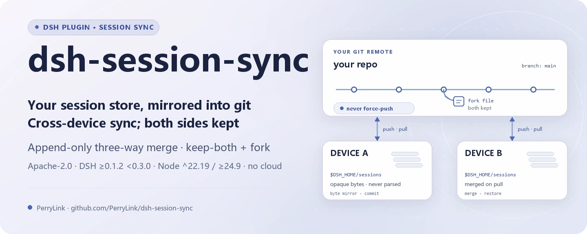
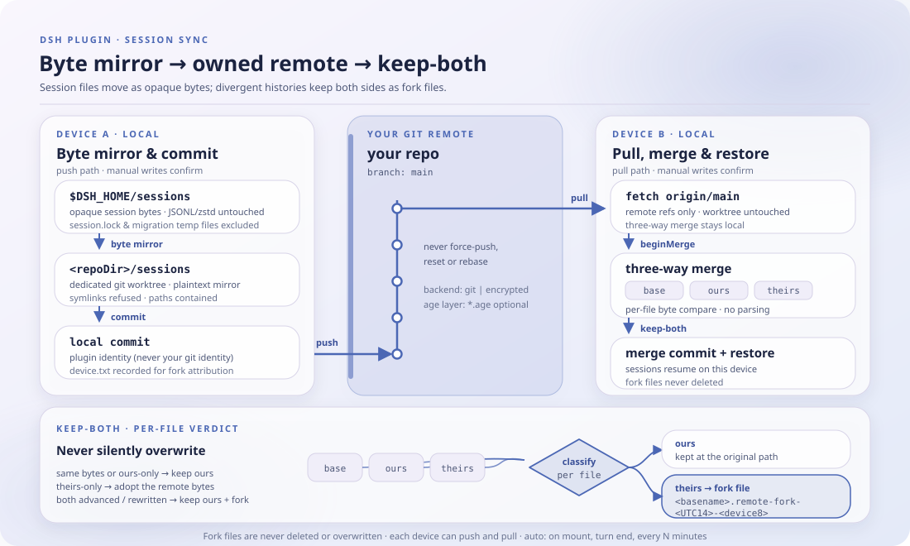

<div align="center">

<picture>
  <source media="(prefers-color-scheme: dark)" srcset="docs/assets/dsh-session-sync-hero-en-dark.webp">
  
</picture>

# dsh-session-sync

**अपने सत्र संग्रह को उस git रिपॉज़िटरी में बदलें जिसे आप नियंत्रित करते हैं — डिवाइसों के बीच सिंक करें, टकराव पर दोनों पक्ष रखें, और एक भी टर्न न खोएँ।**

DeepSeek Harness के लिए शुद्ध host-side सिंक प्लगइन: सत्र फ़ाइलें अपारदर्शी बाइट्स के रूप में कॉपी होती हैं, विचलन append-only तीन-तरफ़ा merge से सुलझता है, और रिमोट आपका अपना होता है (डिफ़ॉल्ट रूप से plaintext git, वैकल्पिक age एन्क्रिप्शन) — कोई क्लाउड सेवा नहीं, कोई तृतीय-पक्ष संग्रहण नहीं।

[इंस्टॉल](#तीन-चरणों-में-शुरुआत) · [कॉन्फ़िगरेशन](#कॉन्फ़िगरेशन) · [FAQ](#faq) · [简体中文](README.md) · [English](README.en.md) · [Español](README.es.md) · [Português](README.pt.md) · [हिन्दी](README.hi.md)

[](LICENSE)
[](#संगतता)
[](https://www.npmjs.com/package/dsh-session-sync)
[](https://github.com/PerryLink/dsh-session-sync/actions/workflows/ci.yml)
[](#संगतता)

[](https://github.com/PerryLink/dsh-session-sync/stargazers)
[](https://www.npmjs.com/package/dsh-session-sync)
[](https://dshfind.com/plugins/PerryLink/dsh-session-sync?ref=badge)
[](https://securityscorecards.dev/viewer/?uri=github.com/PerryLink/dsh-session-sync)
[](https://dsh.market/)
[](https://gitee.com/perrylink/dsh-session-sync)

```sh
dsh plugin --profile <name> add dsh-session-sync
```

</div>

<sub>सामुदायिक प्लगइन, DeepSeek से असंबद्ध। यही एकमात्र आधिकारिक रिपॉज़िटरी है, जिसे PerryLink बनाए रखता है; अन्य खातों की समान-नाम वाली रिपॉज़िटरी इससे संबद्ध नहीं हैं। Gitee एक मिरर है।</sub>

## यह क्या है

`dsh-session-sync` DSH सत्र संग्रह (`$DSH_HOME/sessions`) को एक समर्पित git worktree में मिरर करता है और उसे उस रिमोट से सिंक करता है जिसे **आप** नियंत्रित करते हैं: कोई क्लाउड सेवा नहीं, कोई तृतीय-पक्ष संग्रहण नहीं। सत्र फ़ाइलें अपारदर्शी बाइट्स के रूप में कॉपी होती हैं — प्लगइन JSONL/zstd को कभी पार्स नहीं करता, क्योंकि भौतिक एन्कोडिंग harness की है; उसका काम है उन बाइट्स को ले जाना, append-only इतिहास को merge करना और स्थिति बताना। किसी भी विचलन पर वह append-only तीन-तरफ़ा merge चलाता है: **दोनों पक्ष सुरक्षित रहते हैं**, रिमोट संस्करण fork फ़ाइलों के रूप में बचा रहता है, और कुछ भी चुपचाप अधिलिखित नहीं होता। `backend: git` (डिफ़ॉल्ट) plaintext मिरर है; `backend: encrypted` उसके ऊपर age परत जोड़ता है; सभी ऑटो मोड कॉन्फ़िगर करने योग्य और प्रतिवर्ती हैं।

<p align="center">
  <picture>
    <source media="(prefers-color-scheme: dark)" srcset="docs/assets/dsh-session-sync-flow-v5-dark.svg">
    
  </picture>
</p>

## तीन चरणों में शुरुआत

1. **इंस्टॉल करें** (एक चैनल चुनें):

   ```sh
   # git चैनल (नवीनतम main; git+https://github.com/PerryLink/dsh-session-sync.git के बराबर)
   dsh plugin --profile web add github:PerryLink/dsh-session-sync
   # npm चैनल (प्रकाशित रिलीज़)
   dsh plugin --profile web add dsh-session-sync
   # tarball चैनल: इस रेपो में pnpm pack करके
   dsh plugin --profile web add ./dsh-session-sync-<version>.tgz
   ```

   कोई build चरण नहीं: `index.mjs` और `lib/` ही भेजे गए आर्टिफ़ैक्ट हैं।

2. **न्यूनतम कॉन्फ़िग** (अपने profile patch में एक **निजी** git रिमोट की ओर इंगित करें):

   ```yaml
   - insert:
       - id: session-sync
         name: dsh-session-sync
         config:
           remote: git@github.com:you/your-dsh-sessions.git
   ```

3. **जाँचें कि यह माउंट होता है**:

   ```sh
   dsh --profile web --dump-config | grep -A2 'id: session-sync'
   ```

   ```
   > /sync status
   > /sync pull
   > /sync push
   ```

**अनइंस्टॉल**: `dsh plugin --profile web remove dsh-session-sync` (या profile patch से वह पंक्ति हटा दें)।

## मुख्य क्षमताएँ

`dsh-session-sync` host पर सत्र संग्रह को संस्करण-योग्य git मिरर बनाता है और सिंक की क्रिया आपके रिमोट को सौंपता है:

- **`/sync` कमांड** — `status` (branch, सैनिटाइज़्ड रिमोट, आगे/पीछे, गंदी फ़ाइलें, fork फ़ाइलें), `diff`, `log`, `pull`, `push`, `help`।
- **`sync_status` / `sync_pull` / `sync_push` टूल** — टर्न के भीतर मॉडल के लिए वही सतह।
- **append-only टकराव समाधान** — सत्र लॉग append-only हैं; किसी भी विचलन पर प्लगइन **दोनों** पक्ष रखता है (स्थानीय संस्करण रखा जाता है, रिमोट संस्करण fork फ़ाइलों के रूप में सुरक्षित रहता है) और कभी चुपचाप अधिलिखित नहीं करता। विचलित सत्र सत्र-स्तर पर भी fork हो सकते हैं।
- **ऑटो मोड** — शुरू होने पर pull, हर बंद टर्न के बाद push, और आवधिक pull, सभी कॉन्फ़िगर करने योग्य और प्रतिवर्ती।
- **पुष्टि-द्वार वाली लेखन क्रियाएँ** — `pull`/`push` पहले पूछते हैं (`userQuestions` या `approval` के ज़रिए); केवल-पढ़ने वाली सतहें कभी नहीं पूछतीं; कोई उत्तरदाता न हो तो क्रिया बंद होकर विफल होती है।

```text
डिवाइस A                             रिमोट (आपकी git रिपॉज़िटरी)            डिवाइस B
$DSH_HOME/sessions ──मिरर──▶ commit ──push──▶ [sessions] ──pull──▶ merge (दोनों रखें + fork)
```

### कमांड और टूल

| सतह | केवल पढ़ें | पुष्टि चाहिए | नोट्स |
|---|---|---|---|
| `/sync status` | ✅ | — | Branch, सैनिटाइज़्ड रिमोट, आगे/पीछे, गंदी फ़ाइलें, fork फ़ाइलें, अंतिम pull/push |
| `/sync diff` | ✅ | — | बिना commit बदलाव + `HEAD..remote` आँकड़े (केवल पढ़ें) |
| `/sync log` | ✅ | — | सिंक रिपॉज़िटरी के अंतिम commits |
| `/sync pull` | | ✅ | Fetch + merge, दोनों रखने की शब्दार्थ के साथ; स्थानीय रखा जाता है, रिमोट fork के रूप में सुरक्षित |
| `/sync push` | | ✅ | मिरर + commit + push; कभी force-push नहीं, अस्वीकृति पर एक बार समाधान करके पुनः प्रयास |
| `sync_status` | ✅ | — | मॉडल के लिए `/sync status` जैसे ही तथ्य |
| `sync_pull` | | ✅ | मॉडल द्वारा कॉल करने योग्य pull |
| `sync_push` | | ✅ | मॉडल द्वारा कॉल करने योग्य push |

### उदाहरण

ये प्लगइन के वास्तविक प्रवेश बिंदु हैं; एक बार इंस्टॉल करें, फिर इनमें से एक कॉल करें।

**विस्तृत उदाहरण** — कमांड `/sync help`:

```text
sync: usage — /sync [status | pull | push | diff | log | help]
  status  show mirror state (default): branch, remote, ahead/behind, dirty, forks
  pull    fetch + merge remote changes (keep-both; confirms first)
  push    mirror + commit + push local changes (confirms first)
  diff    uncommitted changes + HEAD..remote stat (read-only)
  log     last commits in the sync repository
```

*Observed from `index.mjs:754-765 (registered /sync handler)`*

**विफलता शाखा** — इनपुट `/sync push`:

```text
sync: cancelled: approval requires an open turn; /sync commands run between turns — mount userQuestions or set confirmVia: userQuestions
```

*Observed from `plugins/dsh-session-sync/lib/gate.mjs:134-137; plugins/dsh-session-sync/index.mjs:792-794; plugins/dsh-session-sync/test/gate.test.mjs:80-88; plugins/dsh-session-sync/README.md:246`*

**संक्षिप्त उदाहरण**: `/sync diff` · `/sync pull`

## कॉन्फ़िगरेशन

सभी समायोज्य Schemastery `Config` फ़ील्ड हैं (cordis.yml से बदले जा सकते हैं)। id-लक्षित ओवरराइड पूरी पंक्ति बदल देता है — हर ज़रूरी कुंजी दोहराएँ। `cordis.patch.yml` हर कुंजी को इनलाइन दस्तावेज़ित करता है।

सबसे अधिक उपयोग होने वाली कुंजियाँ:

| कुंजी | डिफ़ॉल्ट | अर्थ |
|---|---|---|
| `remote` | `''` | रिमोट पता (pull/push से पहले आवश्यक; status/diff इसके बिना चलते हैं) |
| `backend` | `git` | सिंक बैकएंड: `git` (plaintext मिरर) या `encrypted` (age-एन्क्रिप्टेड मिरर सामग्री) |
| `sessionRoot` | `''` | सत्र संग्रह का मूल; खाली = `$DSH_HOME/sessions` (दोनों न हों तो लोड विफल) |
| `repoDir` | `''` | सिंक worktree का मूल; खाली = `$DSH_HOME/dsh-session-sync/repo` |
| `branch` | `main` | रिमोट branch का नाम |
| `autoPushOnTurnEnd` | `false` | हर बंद टर्न के बाद push |
| `pullIntervalMinutes` | `0` | हर N मिनट में आवधिक pull (`0` = बंद, अधिकतम `10080`) |
| `cwdMap` | `[]` | पुनर्स्थापन के समय cwd प्रोजेक्शन `[{from, to}]` (सबसे लंबा प्रीफ़िक्स जीतता है; बिना मेल वाले क्रॉस-प्लेटफ़ॉर्म cwd `<sessionRoot>/--unmapped--` के नीचे केवल-पढ़ने योग्य रहते हैं) |
| `followSessionSymlinks` | `false` | उन सिम्बोलिक लिंक का पालन करें जिनका realpath `sessionRoot` के भीतर ही रहता है (Android/proot निदान) |
| `confirmVia` | `auto` | पुष्टि चैनल: `auto` (पहले userQuestions, फिर approval), `userQuestions`, `approval` |

<details>
<summary>पूरी कॉन्फ़िगरेशन तालिका (24 कुंजियाँ)</summary>

| कुंजी | डिफ़ॉल्ट | अर्थ |
|---|---|---|
| `enabled` | `true` | मुख्य स्विच; `false` कमांड, टूल, listeners और ऑटो मोड हटा देता है |
| `backend` | `git` | सिंक बैकएंड: `git` (plaintext मिरर) या `encrypted` (age-एन्क्रिप्टेड मिरर सामग्री) |
| `sessionRoot` | `''` | सत्र संग्रह का मूल; खाली = `$DSH_HOME/sessions` (दोनों न हों तो लोड विफल) |
| `repoDir` | `''` | सिंक worktree का मूल; खाली = `$DSH_HOME/dsh-session-sync/repo` |
| `remote` | `''` | रिमोट पता (pull/push से पहले आवश्यक; status/diff इसके बिना चलते हैं) |
| `branch` | `main` | रिमोट branch का नाम |
| `gitBin` | `git` | git निष्पादन-योग्य का पथ |
| `ageBin` | `age` | age निष्पादन-योग्य का पथ (`backend: encrypted` के लिए जाँचा जाता है; न मिले तो plaintext पर अवनति) |
| `ageRecipient` | `''` | age प्राप्तकर्ता (सार्वजनिक कुंजी या identity स्ट्रिंग); खाली = एन्क्रिप्ट नहीं कर सकता, plaintext पर अवनति |
| `ageIdentity` | `''` | डिक्रिप्शन के लिए पासफ़्रेज़-रहित age गुप्त कुंजी फ़ाइल का पथ; खाली = डिक्रिप्ट नहीं कर सकता, plaintext पर अवनति |
| `autoPullOnStart` | `false` | प्लगइन माउंट होने पर एक बार pull (कॉन्फ़िग ही अनुमति है; दोबारा पुष्टि नहीं) |
| `autoPushOnTurnEnd` | `false` | हर बंद टर्न के बाद push |
| `durabilityTimeoutMs` | `2000` | ऑटो push से पहले सत्र की durability बाधा (`ctx.sessions.flush`) की प्रतीक्षा की सीमा — होस्ट का JSONL writer live इवेंट को 200 ms तक बैच करता है; टाइमआउट पर लॉग करके push जारी रहता है; `0` = प्रतीक्षा नहीं |
| `pullIntervalMinutes` | `0` | हर N मिनट में आवधिक pull (`0` = बंद, अधिकतम `10080`) |
| `cwdMap` | `[]` | पुनर्स्थापन के समय cwd प्रोजेक्शन `[{from, to}]` (सबसे लंबा प्रीफ़िक्स जीतता है; बिना मेल वाले क्रॉस-प्लेटफ़ॉर्म cwd `<sessionRoot>/--unmapped--` के नीचे केवल-पढ़ने योग्य रहते हैं) |
| `followSessionSymlinks` | `false` | उन सिम्बोलिक लिंक का पालन करें जिनका realpath `sessionRoot` के भीतर ही रहता है (Android/proot निदान) |
| `confirmVia` | `auto` | पुष्टि चैनल: `auto` (पहले userQuestions, फिर approval), `userQuestions`, `approval` |
| `graceMs` | `10000` | git को समाप्त करने की छूट अवधि (ms) |
| `commandTimeoutMs` | `120000` | प्रति-कमांड timeout (ms) |
| `maxOutputBytes` | `262144` | प्रति-स्ट्रीम एकत्र आउटपुट की सीमा (बाइट) |
| `commitName` | `dsh-session-sync` | commit लेखक का नाम |
| `commitEmail` | `dsh-session-sync@localhost` | commit लेखक का ईमेल |
| `registerCommand` | `true` | `/sync` कमांड पंजीकृत करता है |
| `registerTools` | `true` | tools सेवा मौजूद होने पर `sync_*` टूल पंजीकृत करता है |

</details>

आपके profile patch में ओवरराइड का उदाहरण:

```yaml
- insert:
    - id: session-sync
      name: dsh-session-sync
      config:
        remote: git@github.com:you/your-dsh-sessions.git
        branch: main
        autoPushOnTurnEnd: true
        pullIntervalMinutes: 30
        confirmVia: userQuestions
```

## FAQ

<details>
<summary>डेटा वास्तव में कहाँ रहता है? क्या कुछ क्लाउड पर जाता है?</summary>

कोई क्लाउड सेवा नहीं और कोई तृतीय-पक्ष संग्रहण नहीं। आपकी मशीन पर दो प्रतियाँ रहती हैं: `$DSH_HOME/sessions` (harness का सत्र संग्रह) और आपके द्वारा कॉन्फ़िगर किया गया `repoDir` worktree (डिफ़ॉल्ट `$DSH_HOME/dsh-session-sync/repo`); रिमोट **आपकी अपनी** git रिपॉज़िटरी है। `backend: encrypted` केवल भेजी गई/रिमोट प्रतिलिपि को age सिफ़रटेक्स्ट बनाता है — स्थानीय मिरर plaintext ही रहता है।

</details>

<details>
<summary>क्या टकराव किसी सत्र को अधिलिखित या खो सकता है?</summary>

कुछ भी चुपचाप अधिलिखित नहीं होता। सत्र लॉग append-only हैं और तीन-तरफ़ा merge किसी भी विचलन पर दोनों पक्ष रखता है: स्थानीय संस्करण रखा जाता है और रिमोट संस्करण `<basename>.remote-fork-<UTC 14 अंकों की मोहर>-<device8>` नाम की fork फ़ाइल के रूप में सुरक्षित रहता है; fork फ़ाइलें कभी नहीं मिटाई या अधिलिखित होतीं, और git कभी force-push, reset, rebase या branch बदलाव नहीं करता। विचलित सत्र सत्र-स्तर पर भी fork होता है, और संतान में एक स्थायी सूचना डाली जाती है।

</details>

<details>
<summary>क्या एन्क्रिप्शन डिफ़ॉल्ट रूप से चालू है? age न मिले तो क्या होता है?</summary>

नहीं — डिफ़ॉल्ट `backend: git` है, इसलिए सत्र बाइट्स आपके रिमोट में बिना एन्क्रिप्शन के रहते हैं: निजी रिपॉज़िटरी का उपयोग करें। `backend: encrypted` के लिए `age` और खाली-रहित `ageRecipient`/`ageIdentity` चाहिए; कुछ भी न मिले तो प्लगइन स्पष्ट चेतावनी देकर plaintext git पर अवनति करता है — कभी एन्क्रिप्शन का दिखावा नहीं करता। रिमोट को एन्क्रिप्टेड मानने से पहले `/sync status` में चेतावनी देखें।

</details>

<details>
<summary>git न हो या पुष्टि देने वाला कोई न हो तो क्या होता है?</summary>

`git` निष्पादन-योग्य या `subprocess` सेवा न होने पर सिंक क्रियाएँ स्पष्ट कारण के साथ विफल होती हैं (प्रोफ़ाइल फिर भी बूट होती रहती हैं)। `/sync` टर्नों के बीच चलता है, जहाँ `approval` चैनल के पास जुड़ने के लिए कोई खुला टर्न नहीं होता: `confirmVia: userQuestions` रखें, या टर्न के भीतर `sync_*` टूल से सिंक चलाएँ; कोई उत्तरदाता ही न हो तो क्रिया बंद होकर विफल होती है।

</details>

<details>
<summary>कितना ओवरहेड है? क्या ऑटो मोड हमेशा चलते रहते हैं?</summary>

सत्र फ़ाइलें अपारदर्शी बाइट्स के रूप में कॉपी होती हैं और कभी पार्स नहीं होतीं; हर git कमांड में timeout, समाप्ति छूट और प्रति-स्ट्रीम आउटपुट सीमा है। ऑटो push डिफ़ॉल्ट रूप से बंद है, आवधिक pull डिफ़ॉल्ट रूप से बंद है (`pullIntervalMinutes: 0`), और शुरुआत पर pull डिफ़ॉल्ट रूप से बंद है — सक्रिय होने पर वे कॉन्फ़िग की अनुमति से चलते हैं और दोबारा पुष्टि नहीं माँगते। लागत सत्र संग्रह के आकार और रिमोट विलंबता पर निर्भर है; इस रिपॉज़िटरी में कोई benchmark डेटा नहीं है, इसलिए हम गढ़े हुए आँकड़े नहीं देते।

</details>

## सुरक्षा सीमाएँ

- **कभी चुपचाप अधिलेखन नहीं।** append-only तीन-तरफ़ा merge किसी भी विचलन पर दोनों पक्ष रखता है, delete/modify सहित (बदली हुई बाइट्स रखी जाती हैं, हटाने का इरादा सम्मानित होता है); fork फ़ाइलें कभी नहीं मिटाई जातीं, और git कभी force-push, reset, rebase या branch बदलाव नहीं करता।
- **पथ संकोचन।** फ़ाइलें अपारदर्शी बाइट्स के रूप में मिरर होती हैं, symlinks अस्वीकार किए जाते हैं, और हर जोड़े गए पथ की संकोचन-जाँच होती है (`PATH_UNSAFE` ज़ोर से विफल)।
- **सैनिटाइज़्ड आउटपुट।** रिमोट-URL क्रेडेंशियल, टोकन और `key=value` रहस्य मॉडल या लॉग तक पहुँचने से पहले छिपाए जाते हैं; पथ प्रदर्शन अपने मूल से बाहर कुछ भी अस्वीकार करता है।
- **कोई क्रेडेंशियल संग्रहण नहीं।** प्लगइन कोई क्रेडेंशियल संग्रहीत नहीं करता; git क्रेडेंशियल आपके सामान्य git credential helper में रहते हैं। age identity/recipient आप प्रबंधित करते हैं, और कुंजियाँ कभी सिंक रिपॉज़िटरी में नहीं जातीं।
- **git सुदृढ़ीकरण।** git `GIT_TERMINAL_PROMPT=0` और `GIT_OPTIONAL_LOCKS=0` के साथ, समय-सीमा और सिग्नल-सीमा में, प्रति-स्ट्रीम आउटपुट सीमा के साथ चलता है।
- **बंद होकर विफल।** पुष्टि उत्तरदाता न होना, रिमोट न होना या असुरक्षित पथ होना क्रिया को ज़ोर से अस्वीकार करता है।

## अनुमतियाँ और डेटा

- **अनुमतियाँ**: बदलाव करने वाली क्रियाएँ पुष्टि-द्वार (`confirmVia`) से गुज़रती हैं; प्लगइन harness की `userQuestions`/`approval` सेवाओं को कभी दोबारा लागू या बायपास नहीं करता। ऑटो मोड कॉन्फ़िग की अनुमति से चलते हैं और दोबारा पुष्टि नहीं माँगते।
- **डेटा**: सिंक मेटाडेटा (डिवाइस id, अंतिम pull/push, अंतिम push head, अंतिम त्रुटि) `session-sync` स्टोरेज डोमेन में रहता है। सत्र फ़ाइलें अपारदर्शी बाइट्स के रूप में कॉपी होती हैं — प्लगइन उन्हें कभी पार्स नहीं करता। डिवाइस id सिंक रिपॉज़िटरी के `device.txt` में भी लिखा जाता है, ताकि क्रॉस-डिवाइस fork श्रेय संभव हो।
- **सत्र लॉग**: `sync/push`, `sync/pull` और `sync/conflict` `types.d.ts` में घोषित हैं; वे केवल तब जोड़े जाते हैं जब host उन प्रकारों को दर्ज करता है (ज्ञात सीमाएँ देखें)। जो कुछ लिखा या दिखाया जाता है, वह सैनिटाइज़्ड होता है। प्लगइन का एकमात्र स्थायी संदेश — टकराव fork सूचना — प्लगइन का अपना producer-owned source kind (`dsh-session-sync`) रखता है; harness ने साझा `plugin` kind रिटायर कर दिया है और सत्र पढ़ते समय उसे अस्वीकार करता है।

## एन्क्रिप्शन और ख़तरा मॉडल

`backend: encrypted` मिरर के ऊपर एक वैकल्पिक **age** परत जोड़ता है: सत्र बाइट्स commit और push होने से पहले `encrypted/**/*.age` फ़ाइलों में एन्क्रिप्ट होते हैं, और merge से पहले स्थानीय plaintext मिरर में वापस डिक्रिप्ट होते हैं। तीन-तरफ़ा merge हमेशा स्थानीय स्तर पर plaintext पर चलता है, इसलिए append-only "दोनों रखें" शब्दार्थ अपरिवर्तित रहता है।

एन्क्रिप्शन क्या **बचाता** है:

- **रिमोट में विराम की स्थिति में मिरर सामग्री।** आप जो सत्र फ़ाइलें भेजते हैं वे age सिफ़रटेक्स्ट हैं; रिमोट host, उसके ऑपरेटर और रिपॉज़िटरी क्लोन करने वाला कोई भी व्यक्ति निजी कुंजी के बिना plaintext सत्र बाइट्स नहीं देख सकता।

एन्क्रिप्शन क्या **नहीं** बचाता (सीमा):

- **कुंजियाँ और age identities आपकी ज़िम्मेदारी हैं।** recipient/identity फ़ाइलें प्लगइन कभी वितरित, संग्रहीत या घुमाता नहीं। कुंजी लीक होने पर उसकी सुरक्षित मिरर सामग्री उजागर हो जाती है। पासफ़्रेज़-रहित identity उपयोग करें और उसे रिपॉज़िटरी के बाहर रखें।
- **रिमोट व्यवहार में अब भी एक निजी रिपॉज़िटरी है।** git मेटाडेटा — commit संदेश, `.gitignore`, `encrypted/` पथ संरचना, branch नाम और push/fetch गतिविधि — रिमोट host को दिखता रहता है। एन्क्रिप्शन *सामग्री* छिपाता है, न कि यह तथ्य कि आप सिंक करते हैं, और न ही आपके सत्र-वृक्ष का आकार।
- **plaintext स्थानीय रूप से अब भी मौजूद है।** `<repoDir>/sessions/` का मिरर डिस्क पर plaintext है; एन्क्रिप्शन भेजी गई/रिमोट प्रतिलिपि की रक्षा करता है, स्थानीय डिस्क एन्क्रिप्शन या चालू सत्र संग्रह की नहीं।
- **सौम्य अवनति का अर्थ plaintext है।** `backend: encrypted` के साथ, यदि `age` नहीं है, या `ageRecipient`/`ageIdentity` खाली हैं, तो प्लगइन plaintext git पथ पर लौटता है **और स्थिति/लॉग में स्पष्ट चेतावनी देता है** — कभी चुपचाप एन्क्रिप्टेड होने का दिखावा नहीं करता। रिमोट को एन्क्रिप्टेड मानने से पहले `/sync status` में चेतावनी देखें।

आधार रेखा: `backend: git` (डिफ़ॉल्ट) के साथ सत्र बाइट्स **आपके** git रिमोट में बिना एन्क्रिप्शन के संग्रहीत होते हैं — निजी रिपॉज़िटरी का उपयोग करें।

### क्रॉस-प्लेटफ़ॉर्म सत्र और cwd प्रोजेक्शन

Windows से Linux (या उलटा) सिंक किए गए सत्र का `header.cwd` प्राप्तकर्ता होस्ट पर मूल निरपेक्ष पथ नहीं होता: `dsh-workspace` सत्रों को `realpath(header.cwd)` से अनुक्रमित करता है, और `session-persistence-jsonl` ऐसे header को पढ़ ही नहीं सकता जिसका cwd मूल रूप से निरपेक्ष न हो। स्रोत प्रीफ़िक्स को स्थानीय पथ पर मैप करें:

```yaml
cwdMap:
  - from: 'C:\Users\me'
    to: /home/me/win
```

- सबसे लंबा मिलता प्रीफ़िक्स जीतता है, और प्रीफ़िक्स पथ-खंड सीमा पर समाप्त होना चाहिए (`C:\Users\me2` `C:\Users\me` से मेल नहीं खाता)।
- पुनर्स्थापन केवल **स्थानीय प्रति** को प्रोजेक्ट करता है: उसका पहला फ़्रेम स्थानीय cwd लेकर होस्ट के प्रोजेक्ट निर्देशिका में जाता है, इसलिए सत्र workspace सूची में दिखता है। मिरर स्रोत डिवाइस के बाइट्स रखता है; push मूल हेडर फ़्रेम को फिर जोड़ देता है, इसलिए दूसरा डिवाइस अभी भी बाइट-दर-बाइट समान appends देखता है और व्यर्थ conflicts नहीं पाता।
- बिना मेल वाला क्रॉस-प्लेटफ़ॉर्म cwd `<sessionRoot>/--unmapped--` में जाता है: **दिखता है पर केवल-पढ़ने योग्य** (`sync_status` इसे `cwdUnmapped` बताता है, और स्थानीय बदलाव कभी push नहीं होते)। `cwdMap` प्रविष्टि जोड़कर फिर pull करें तो यह जारी रखने योग्य स्थानीय सत्र बन जाता है।

### सिम्बोलिक लिंक (Android/proot)

मिरर डिफ़ॉल्ट रूप से **सिम्बोलिक लिंक का पालन कभी नहीं करता** (सुरक्षा सीमा)। Android/proot का `link2symlink` होस्ट द्वारा लिखी सत्र फ़ाइलों को सिम्बोलिक लिंक बताता है (`readdir` लिंक कहता है, `readlink` खाली है, बाइट्स पढ़े जा सकते हैं), इसलिए फ़ोन के अपने सत्र मिरर तक कभी नहीं पहुँचते। निदान और वैकल्पिक पालन:

- `sync_status` अब `skippedSymlinks` / `skippedSymlinkPaths` (गिनती और पथ नमूने) तथा `followedSymlinks` बताता है; push परिणाम में वही चेतावनी आती है।
- `followSessionSymlinks: true` (डिफ़ॉल्ट `false`) केवल उन लिंक का पालन करता है जिनका `realpath` `sessionRoot` के भीतर रहता है; बाहर जाने वाले लिंक हमेशा छोड़े और गिने जाते हैं।

## ज्ञात सीमाएँ

- **एन्क्रिप्शन वैकल्पिक है, और age बाहरी निर्भरता है।** `backend: encrypted` age परत जोड़ता है (ऊपर «एन्क्रिप्शन और ख़तरा मॉडल» देखें); `age` न होना या `ageRecipient`/`ageIdentity` का खाली होना स्पष्ट चेतावनी देकर plaintext पर अवनति करता है, और पासफ़्रेज़-संरक्षित identity उपयोग नहीं की जा सकती (डिक्रिप्शन TTY प्रॉम्प्ट पर अटक जाता, इसलिए बंद होकर विफल होता है)। `backend: git` (डिफ़ॉल्ट) के साथ सत्र बाइट्स **आपके** git रिमोट में बिना एन्क्रिप्शन के रहते हैं — निजी रिपॉज़िटरी का उपयोग करें।
- **`object-storage` एक आरक्षित इंटरफ़ेस है।** यह इंटरफ़ेस प्लेसहोल्डर है और लोड पर ज़ोर से विफल होता है; केवल `git` और `encrypted` लागू हैं।
- **git आवश्यक है।** प्लगइन को `git` निष्पादन-योग्य और `subprocess` सेवा चाहिए; उनके बिना सिंक क्रियाएँ स्पष्ट कारण के साथ विफल होती हैं (प्रोफ़ाइल बूट होती रहती हैं)।
- **प्रति बैकएंड एक `repoDir`।** एक ही `repoDir` पर `git` और `encrypted` के बीच बदलना समर्थित नहीं है; प्रति बैकएंड नया worktree उपयोग करें।
- **`0.1.0-rc.6`/`0.1.0-rc.8`/`0.1.1-rc.2`/`0.1.2-alpha.2`/`0.1.2-alpha.3`/`0.1.2-rc.1`/`0.1.7-alpha.2` पर सत्र घटनाएँ।** harness `sync/*` घटना प्रकार दर्ज नहीं करता, इसलिए सत्र-लॉग जोड़े छोड़ दिए जाते हैं (सत्र लोड होते रहते हैं); जब host प्रकार दर्ज करता है या `Session.append` पर `ignorable` envelope उजागर करता है, प्लगइन उन्हें स्वतः सक्षम कर देता है।
- **टर्नों के बीच `approval`।** `/sync` टर्नों के बीच चलता है, जहाँ `approval` चैनल के पास जुड़ने के लिए खुला टर्न नहीं होता; कमांड-चालित सिंक के लिए `confirmVia: userQuestions` उपयोग करें, या टर्न के भीतर टूल से सिंक चलाएँ। खुले टर्न की जाँच host के `turnBoundary` सत्र प्रोजेक्शन को पढ़ती है: `@deepseek-ai/dsh-session-projection` के बिना संरचना टर्न स्थिति सत्यापित नहीं कर सकती और उस कारण से बंद होकर विफल होती है।
- **host-निजी आर्टिफ़ैक्ट सिंक नहीं होते।** `session.lock` (harness सत्र लीज़) और `session.migration.*.tmp` स्टेजिंग फ़ाइलें कभी मिरर या हटाई नहीं जातीं — वे रनटाइम स्थिति हैं, सिंक-योग्य सामग्री नहीं। सत्र लॉग (`session.jsonl`, `session.v[1-9]*.jsonl[.zstd]`) अब भी मिरर की जाने वाली पेलोड हैं।

## संगतता

| सतह | स्थिति |
|---|---|
| Harness | DeepSeek Harness `dsh-v0.2.1-alpha.1` (GitHub tag, 2026-09-25 को सत्यापित: पिन किए गए `0.1.7-rc.2` peers के विरुद्ध पूरी गेट श्रृंखला)। npm निर्भरता पंक्ति `0.1.7-rc.2`, peers `>=0.1.2-rc.1 <0.2.0 \|\| >=0.1.5-alpha.1 <0.2.0 \|\| >=0.1.6-0 <0.2.0 \|\| >=0.1.7-0 <0.2.0`। (2026-10-04 को अनुकूलित): टकराव fork सूचना प्लगइन का अपना producer-owned संदेश source kind रखती है — harness ने साझा `plugin` kind रिटायर कर दिया और पढ़ते समय उसे अस्वीकार करता है। |
| Node | `^22.19.0 \|\| >=24.9.0` |
| प्लेटफ़ॉर्म | जहाँ भी `git` और DSH चलते हैं (git-आधारित मिरर; कोई प्लेटफ़ॉर्म-विशिष्ट कोड नहीं) |
| मॉडल | केवल-पाठ मॉडल पूरी तरह समर्थित; किसी दृष्टि या अतिरिक्त मॉडल क्षमता की आवश्यकता नहीं |

## पारिस्थितिकी और गुणवत्ता

- [Gitee मिरर](https://gitee.com/perrylink/dsh-session-sync) (सिंक किया गया मिरर; GitHub आधिकारिक है)
- [dshfind प्लगइन पेज](https://dshfind.com/plugins/PerryLink/dsh-session-sync) (इंस्टॉल और रैंकिंग)
- [OpenSSF Scorecard रिपोर्ट](https://securityscorecards.dev/viewer/?uri=github.com/PerryLink/dsh-session-sync) ([.github/workflows/scorecard.yml](.github/workflows/scorecard.yml) से संचालित)
- [dsh-plugin-doctor सत्यापन रिपोर्ट](https://github.com/PerryLink/dsh-plugin-doctor#verified-徽章) (K10–K13 का ऐतिहासिक सत्यापन बैज)
- [DSH Market](https://dsh.market/) (सूचीबद्ध)
- **1024 स्टोर चैनल**: एक बार `npm i -g dsh1024`, फिर `dsh1024 plugin --profile web add dsh-session-sync` ([deepseek1024.com](https://deepseek1024.com) की इंस्टॉल रैंकिंग में गिना जाता है)
- [पारिस्थितिकी ज्ञान-आधार](https://perrylink.github.io/dsh-plugin-guide/): प्लगइन विकास गाइड · मापा गया चयन डेटा · रखरखाव के निर्णय-मानदंड

## विकास

```sh
pnpm install                                       # node ^22.19 || >=24.9
pnpm run typecheck && pnpm run typecheck:ci        # tsc --checkJs: checkout फ़ेस + प्रकाशित-लाइन फ़ेस
pnpm test                                          # node --test (14 टेस्ट फ़ाइलें; git के बिना engine की git सूट छूट जाती है)
pnpm run verify:self-contained                     # निर्भरता specs registry से हल होती हैं
pnpm run verify:artifacts                          # भेजी गई फ़ाइलें मौजूद + index.mjs इम्पोर्ट योग्य
pnpm run check:readmes                             # पाँच-भाषा README संगति
pnpm pack                                          # प्रकाशित tarball
```

कोई build चरण नहीं: शुद्ध ESM, `index.mjs` और `lib/` ही भेजे गए आर्टिफ़ैक्ट हैं। README की छवियाँ [`scripts/gen-readme-assets.py`](scripts/gen-readme-assets.py) (Python + Pillow) से प्रोग्रामेटिक रूप से बनती हैं और सुरक्षित रूप से दोबारा चलाई जा सकती हैं।

Topics: `dsh`, `dsh-plugin`, `deepseek-harness`, `deepseek`, `cordis`, `session-sync`, `session`, `git`, `sync`, `cross-device`

## परिवार और आभार

यह प्रोजेक्ट [PerryLink](https://github.com/PerryLink) के DeepSeek Harness प्लगइन परिवार का हिस्सा है (सभी Apache-2.0)। अगर यह उपयोगी लगे, तो **एक स्टार अगले व्यक्ति को इसे खोजने में मदद करता है** — इसके पीछे कुछ भी लॉक नहीं है।

- [@BlakrPander](https://github.com/BlakrPander) — PAT-as-username रिडैक्शन और delete/modify के "दोनों रखें" विश्लेषण (#14); दोनों हिस्से 0.2.27/0.2.28 में आए।
- [@PerryLink](https://github.com/PerryLink) — निर्माता और रखरखावकर्ता: git मिरर इंजन, append-only "दोनों रखें" merge, `/sync` कमांड और `sync_*` टूल, ऑटो मोड, सैनिटाइज़र और पाँच-भाषा दस्तावेज़।

<details>
<summary>सभी प्लगइन खोलें</summary>

| प्लगइन | स्थिति |
|---|---|
| **[dsh-aqua-input-check](https://github.com/PerryLink/dsh-aqua-input-check)** |  |
| **[dsh-archive-check](https://github.com/PerryLink/dsh-archive-check)** |  |
| **[dsh-auto-review](https://github.com/PerryLink/dsh-auto-review)** |  |
| **[dsh-autotier](https://github.com/PerryLink/dsh-autotier)** | 🧊 फ़्रोज़न — रेपो README देखें |
| **[dsh-bid-ca-precheck](https://github.com/PerryLink/dsh-bid-ca-precheck)** |  |
| **[dsh-bid-qual-check](https://github.com/PerryLink/dsh-bid-qual-check)** |  |
| **[dsh-cert-mcp](https://github.com/PerryLink/dsh-cert-mcp)** | 🧊 फ़्रोज़न — रेपो README देखें |
| **[dsh-checkpoint-rewind](https://github.com/PerryLink/dsh-checkpoint-rewind)** |  |
| **[dsh-click](https://github.com/PerryLink/dsh-click)** |  |
| **[dsh-composer-history](https://github.com/PerryLink/dsh-composer-history)** |  |
| **[dsh-contract-stance](https://github.com/PerryLink/dsh-contract-stance)** |  |
| **[dsh-customs-doc-check](https://github.com/PerryLink/dsh-customs-doc-check)** |  |
| **[dsh-data-quality](https://github.com/PerryLink/dsh-data-quality)** | 🧊 फ़्रोज़न — रेपो README देखें |
| **[dsh-demurrage-ledger](https://github.com/PerryLink/dsh-demurrage-ledger)** |  |
| **[dsh-doublecheck](https://github.com/PerryLink/dsh-doublecheck)** |  |
| **[dsh-drill-script-check](https://github.com/PerryLink/dsh-drill-script-check)** |  |
| **[dsh-eia-guide-check](https://github.com/PerryLink/dsh-eia-guide-check)** |  |
| **[dsh-emergency-plan](https://github.com/PerryLink/dsh-emergency-plan)** |  |
| **[dsh-essay-rubric-check](https://github.com/PerryLink/dsh-essay-rubric-check)** |  |
| **[dsh-evidence-check](https://github.com/PerryLink/dsh-evidence-check)** |  |
| **[dsh-export-ctl-check](https://github.com/PerryLink/dsh-export-ctl-check)** |  |
| **[dsh-fast](https://github.com/PerryLink/dsh-fast)** |  |
| **[dsh-fmea-table-check](https://github.com/PerryLink/dsh-fmea-table-check)** |  |
| **[dsh-forecast-penalty](https://github.com/PerryLink/dsh-forecast-penalty)** |  |
| **[dsh-fund-research](https://github.com/PerryLink/dsh-fund-research)** |  |
| **[dsh-github](https://github.com/PerryLink/dsh-github)** |  |
| **[dsh-gongwen-flow-check](https://github.com/PerryLink/dsh-gongwen-flow-check)** |  |
| **[dsh-gongwen-word-check](https://github.com/PerryLink/dsh-gongwen-word-check)** |  |
| **[dsh-guard-plan-qc](https://github.com/PerryLink/dsh-guard-plan-qc)** |  |
| **[dsh-hazchem-check](https://github.com/PerryLink/dsh-hazchem-check)** |  |
| **[dsh-hazplan-check](https://github.com/PerryLink/dsh-hazplan-check)** |  |
| **[dsh-hidden-risk-map](https://github.com/PerryLink/dsh-hidden-risk-map)** |  |
| **[dsh-hs-classify](https://github.com/PerryLink/dsh-hs-classify)** |  |
| **[dsh-icd-rule-check](https://github.com/PerryLink/dsh-icd-rule-check)** |  |
| **[dsh-industry-research](https://github.com/PerryLink/dsh-industry-research)** |  |
| **[dsh-lawcite-adapter](https://github.com/PerryLink/dsh-lawcite-adapter)** |  |
| **[dsh-laya](https://github.com/PerryLink/dsh-laya)** |  |
| **[dsh-lc-doc-check](https://github.com/PerryLink/dsh-lc-doc-check)** |  |
| **[dsh-learning-gap-check](https://github.com/PerryLink/dsh-learning-gap-check)** |  |
| **[dsh-library](https://github.com/PerryLink/dsh-library)** |  |
| **[dsh-local-ai](https://github.com/PerryLink/dsh-local-ai)** |  |
| **[dsh-lsp-actions](https://github.com/PerryLink/dsh-lsp-actions)** |  |
| **[dsh-mask](https://github.com/PerryLink/dsh-mask)** |  |
| **[dsh-mcp-panel](https://github.com/PerryLink/dsh-mcp-panel)** |  |
| **[dsh-medrec-qc](https://github.com/PerryLink/dsh-medrec-qc)** |  |
| **[dsh-memento](https://github.com/PerryLink/dsh-memento)** | 🧊 फ़्रोज़न — रेपो README देखें |
| **[dsh-nsfc-form-check](https://github.com/PerryLink/dsh-nsfc-form-check)** |  |
| **[dsh-nurse-record-check](https://github.com/PerryLink/dsh-nurse-record-check)** |  |
| **[dsh-observe](https://github.com/PerryLink/dsh-observe)** |  |
| **[dsh-origin-rvc-check](https://github.com/PerryLink/dsh-origin-rvc-check)** |  |
| **[dsh-ota-review-check](https://github.com/PerryLink/dsh-ota-review-check)** |  |
| **[dsh-output-styles](https://github.com/PerryLink/dsh-output-styles)** |  |
| **[dsh-paper-doc-adapter](https://github.com/PerryLink/dsh-paper-doc-adapter)** |  |
| **[dsh-permission-rules](https://github.com/PerryLink/dsh-permission-rules)** |  |
| **[dsh-permit-report-check](https://github.com/PerryLink/dsh-permit-report-check)** |  |
| **[dsh-pipeline-check](https://github.com/PerryLink/dsh-pipeline-check)** |  |
| **[dsh-pleading-draft](https://github.com/PerryLink/dsh-pleading-draft)** |  |
| **[dsh-plugin-doctor](https://github.com/PerryLink/dsh-plugin-doctor)** | 🚫 रिटायर्ड (रेपो संग्रहीत) |
| **[dsh-plugin-guide](https://github.com/PerryLink/dsh-plugin-guide)** |  |
| **[dsh-plugin-kit](https://github.com/PerryLink/dsh-plugin-kit)** | 🚫 रिटायर्ड (रेपो संग्रहीत) |
| **[dsh-plugin-upgrade](https://github.com/PerryLink/dsh-plugin-upgrade)** | 🚫 रिटायर्ड (रेपो संग्रहीत) |
| **[dsh-policy-brief-draft](https://github.com/PerryLink/dsh-policy-brief-draft)** |  |
| **[dsh-power-loss-split](https://github.com/PerryLink/dsh-power-loss-split)** |  |
| **[dsh-power-ticket-check](https://github.com/PerryLink/dsh-power-ticket-check)** |  |
| **[dsh-ppap-check](https://github.com/PerryLink/dsh-ppap-check)** |  |
| **[dsh-protest-deadline](https://github.com/PerryLink/dsh-protest-deadline)** |  |
| **[dsh-railway-window](https://github.com/PerryLink/dsh-railway-window)** |  |
| **[dsh-repair-order-qc](https://github.com/PerryLink/dsh-repair-order-qc)** |  |
| **[dsh-research-report](https://github.com/PerryLink/dsh-research-report)** |  |
| **[dsh-review-reply-check](https://github.com/PerryLink/dsh-review-reply-check)** |  |
| **[dsh-rulefile-check](https://github.com/PerryLink/dsh-rulefile-check)** |  |
| **[dsh-safety-brief-check](https://github.com/PerryLink/dsh-safety-brief-check)** |  |
| **[dsh-score](https://github.com/PerryLink/dsh-score)** | 🧊 फ़्रोज़न — रेपो README देखें |
| **[dsh-session-sync](https://github.com/PerryLink/dsh-session-sync)** |  |
| **[dsh-site-log-check](https://github.com/PerryLink/dsh-site-log-check)** |  |
| **[dsh-skill-pack-security](https://github.com/PerryLink/dsh-skill-pack-security)** |  |
| **[dsh-soe-decision-check](https://github.com/PerryLink/dsh-soe-decision-check)** |  |
| **[dsh-soilwater-check](https://github.com/PerryLink/dsh-soilwater-check)** |  |
| **[dsh-sop-sync-check](https://github.com/PerryLink/dsh-sop-sync-check)** |  |
| **[dsh-spc-gbt-adapter](https://github.com/PerryLink/dsh-spc-gbt-adapter)** |  |
| **[dsh-talk](https://github.com/PerryLink/dsh-talk)** |  |
| **[dsh-tender-extract](https://github.com/PerryLink/dsh-tender-extract)** |  |
| **[dsh-tender-matrix](https://github.com/PerryLink/dsh-tender-matrix)** |  |
| **[dsh-test-drive](https://github.com/PerryLink/dsh-test-drive)** |  |
| **[dsh-ticktick](https://github.com/PerryLink/dsh-ticktick)** | 🚫 रिटायर्ड (रेपो संग्रहीत) |
| **[dsh-translate](https://github.com/PerryLink/dsh-translate)** |  |
| **[dsh-warranty-calc](https://github.com/PerryLink/dsh-warranty-calc)** |  |
| **[dsh-budget](https://github.com/PerryLink/dsh-budget)** | 🧊 फ़्रोज़न — रेपो README देखें |
| **[dsh-claude-move](https://github.com/PerryLink/dsh-claude-move)** | 🧊 फ़्रोज़न — रेपो README देखें |
| **[dsh-defend](https://github.com/PerryLink/dsh-defend)** | 🧊 फ़्रोज़न — रेपो README देखें |
| **[dsh-draw](https://github.com/PerryLink/dsh-draw)** | 🧊 फ़्रोज़न — रेपो README देखें |
| **[dsh-reach](https://github.com/PerryLink/dsh-reach)** | 🧊 फ़्रोज़न — रेपो README देखें |
| **[dsh-background-agents](https://github.com/PerryLink/dsh-background-agents)** | 🚫 रिटायर्ड (रेपो संग्रहीत) |
| **[dsh-session-pin](https://github.com/PerryLink/dsh-session-pin)** | 🚫 रिटायर्ड (रेपो संग्रहीत) |
| **[dsh-team-rooms](https://github.com/PerryLink/dsh-team-rooms)** | 🚫 रिटायर्ड (रेपो संग्रहीत) |

</details>

## लाइसेंस

[LICENSE](LICENSE) (Apache License 2.0) © 2026 dsh-session-sync contributors

<p align="center"><sub>Apache-2.0 · सामुदायिक प्लगइन, DeepSeek से असंबद्ध।</sub></p>
