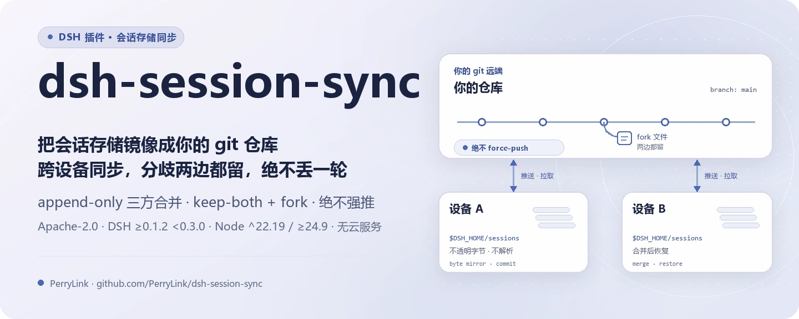
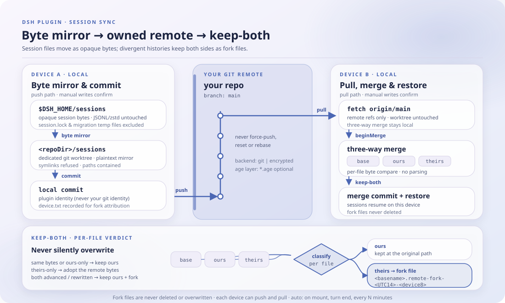

<div align="center">

<picture>
  <source media="(prefers-color-scheme: dark)" srcset="docs/assets/dsh-session-sync-hero-zh-dark.webp">
  
</picture>

# dsh-session-sync

**把会话存储镜像成你自己控制的 git 仓库——跨设备同步，冲突两边都留，绝不丢一轮。**

面向 DeepSeek Harness 的纯主机端同步插件：会话文件按不透明字节复制，append-only 三方合并，远端由你选（默认明文 git，可选 age 加密），无云服务、无第三方存储。

[安装](#三步上手) · [配置](#配置) · [FAQ](#faq) · [简体中文](README.md) · [English](README.en.md) · [Español](README.es.md) · [Português](README.pt.md) · [हिन्दी](README.hi.md)

[](LICENSE)
[](#兼容性)
[](https://www.npmjs.com/package/dsh-session-sync)
[](https://github.com/PerryLink/dsh-session-sync/actions/workflows/ci.yml)
[](#兼容性)

[](https://github.com/PerryLink/dsh-session-sync/stargazers)
[](https://www.npmjs.com/package/dsh-session-sync)
[](https://dshfind.com/plugins/PerryLink/dsh-session-sync?ref=badge)
[](https://securityscorecards.dev/viewer/?uri=github.com/PerryLink/dsh-session-sync)
[](https://dsh.market/)
[](https://gitee.com/perrylink/dsh-session-sync)

```sh
dsh plugin --profile <name> add dsh-session-sync
```

</div>

<sub>社区插件，与 DeepSeek 官方无关。本仓库是唯一官方仓库，由 PerryLink 维护；其他账号下的同名仓库与本项目无关。Gitee 为镜像。</sub>

## 它是什么

`dsh-session-sync` 把 DSH 会话存储（`$DSH_HOME/sessions`）镜像到一个专用 git 工作树，再同步到**你自己**控制的远端：没有云服务，没有第三方存储。会话文件按不透明字节复制，插件从不解析 JSONL/zstd——物理编码属于 harness，插件的职责只是搬运字节、合并 append-only 历史并报告状态。发生分歧时走 append-only 三方合并：**两边都保留**，远端版本留存为 fork 文件，绝不静默覆盖。默认 `backend: git` 是明文镜像；`backend: encrypted` 在镜像之上加一层 age 加密；自动模式全部可配置、可逆。

<p align="center">
  <picture>
    <source media="(prefers-color-scheme: dark)" srcset="docs/assets/dsh-session-sync-flow-v5-dark.svg">
    
  </picture>
</p>

## 三步上手

1. **安装**（三选一）：

   ```sh
   # git 通道（最新 main；等价于 git+https://github.com/PerryLink/dsh-session-sync.git）
   dsh plugin --profile web add github:PerryLink/dsh-session-sync
   # npm 通道（已发布版本）
   dsh plugin --profile web add dsh-session-sync
   # tarball 通道：本仓库 pnpm pack 后
   dsh plugin --profile web add ./dsh-session-sync-<version>.tgz
   ```

   无构建步骤——`index.mjs` 与 `lib/` 即发布产物。

2. **最小配置**（在你的 profile patch 里指向一个**私有** git 远端）：

   ```yaml
   - insert:
       - id: session-sync
         name: dsh-session-sync
         config:
           remote: git@github.com:you/your-dsh-sessions.git
   ```

3. **验证已生效**：

   ```sh
   dsh --profile web --dump-config | grep -A2 'id: session-sync'
   ```

   ```
   > /sync status
   > /sync pull
   > /sync push
   ```

**卸载**：`dsh plugin --profile web remove dsh-session-sync`（或从 profile patch 删掉该行）。

## 核心能力

`dsh-session-sync` 在主机侧把会话存储变成可版本化的 git 镜像，并把同步动作交给你的远端：

- **`/sync` 命令** —— `status`（分支、脱敏后的远端、领先/落后、未提交文件、fork 文件）、`diff`、`log`、`pull`、`push`、`help`。
- **`sync_status` / `sync_pull` / `sync_push` 工具** —— 在轮次内为模型提供同样的能力。
- **append-only 冲突裁决** —— 会话日志是 append-only；任何分歧都会**两边都保留**（本地版本保留、远端版本留存为 fork 文件），绝不静默覆盖。分歧的会话还可在会话层面 fork。
- **自动模式** —— 启动时拉取、每个关闭轮次后推送、周期拉取，全部可配置且可逆。
- **写操作走确认门** —— `pull`/`push` 会先询问（经 `userQuestions` 或 `approval`）；只读界面从不询问；没有回答者时操作失败关闭。

```text
设备 A                              远端（你的 git 仓库）                  设备 B
$DSH_HOME/sessions ──镜像──▶ 提交 ──推送──▶ [sessions] ──拉取──▶ 合并（两边保留 + fork）
```

### 命令与工具面

| 界面 | 只读 | 需要确认 | 说明 |
|---|---|---|---|
| `/sync status` | ✅ | — | 分支、脱敏远端、领先/落后、未提交文件、fork 文件、最近推/拉 |
| `/sync diff` | ✅ | — | 未提交变更 + `HEAD..remote` 统计（只读） |
| `/sync log` | ✅ | — | 同步仓库最近提交 |
| `/sync pull` | | ✅ | fetch + 合并（两边保留语义；本地保留、远端留存为 fork） |
| `/sync push` | | ✅ | 镜像 + 提交 + 推送；绝不强推，被拒时拉取调和后重试一次 |
| `sync_status` | ✅ | — | 为模型提供 `/sync status` 同样的信息 |
| `sync_pull` | | ✅ | 模型可调用的拉取 |
| `sync_push` | | ✅ | 模型可调用的推送 |

### 示例

以下为插件真实入口；安装后调用一个即可。

**详细示例** —— 命令 `/sync help`：

```text
sync: usage — /sync [status | pull | push | diff | log | help]
  status  show mirror state (default): branch, remote, ahead/behind, dirty, forks
  pull    fetch + merge remote changes (keep-both; confirms first)
  push    mirror + commit + push local changes (confirms first)
  diff    uncommitted changes + HEAD..remote stat (read-only)
  log     last commits in the sync repository
```

*Observed from `index.mjs:754-765 (registered /sync handler)`*

**失败分支** —— 输入 `/sync push`：

```text
sync: cancelled: approval requires an open turn; /sync commands run between turns — mount userQuestions or set confirmVia: userQuestions
```

*Observed from `plugins/dsh-session-sync/lib/gate.mjs:134-137; plugins/dsh-session-sync/index.mjs:792-794; plugins/dsh-session-sync/test/gate.test.mjs:80-88; plugins/dsh-session-sync/README.md:246`*

**简短示例**：`/sync diff` · `/sync pull`

## 配置

所有可调项都是 Schemastery `Config` 字段（可从 cordis.yml 覆盖）。按 id 覆盖会替换整行——请重述所有需要的键。`cordis.patch.yml` 逐键内联注释。

最常用键：

| 键 | 默认值 | 含义 |
|---|---|---|
| `remote` | `''` | 远端地址（pull/push 前必须非空；status/diff 无需） |
| `backend` | `git` | 同步后端：`git`（明文镜像）或 `encrypted`（age 加密镜像内容） |
| `sessionRoot` | `''` | 会话存储根；空 = `$DSH_HOME/sessions`（两者皆缺加载失败） |
| `repoDir` | `''` | 同步工作树根；空 = `$DSH_HOME/dsh-session-sync/repo` |
| `branch` | `main` | 远端分支名 |
| `autoPushOnTurnEnd` | `false` | 每个关闭轮次后推送 |
| `pullIntervalMinutes` | `0` | 每 N 分钟周期拉取（`0` = 关闭，最大 `10080`） |
| `confirmVia` | `auto` | 确认通道：`auto`（优先 userQuestions，其次 approval）、`userQuestions`、`approval` |

<details>
<summary>完整配置表（21 个键）</summary>

| 键 | 默认值 | 含义 |
|---|---|---|
| `enabled` | `true` | 总开关；`false` 卸载命令、工具、监听器与自动模式 |
| `backend` | `git` | 同步后端：`git`（明文镜像）或 `encrypted`（age 加密镜像内容） |
| `sessionRoot` | `''` | 会话存储根；空 = `$DSH_HOME/sessions`（两者皆缺加载失败） |
| `repoDir` | `''` | 同步工作树根；空 = `$DSH_HOME/dsh-session-sync/repo` |
| `remote` | `''` | 远端地址（pull/push 前必须非空；status/diff 无需） |
| `branch` | `main` | 远端分支名 |
| `gitBin` | `git` | git 可执行路径 |
| `ageBin` | `age` | age 可执行路径（`backend: encrypted` 时探测；缺失降级明文） |
| `ageRecipient` | `''` | age 收件人（公钥/身份串）；空 = 无法加密、降级明文 |
| `ageIdentity` | `''` | 无口令 age 私钥文件路径（用于解密）；空 = 无法解密、降级明文 |
| `autoPullOnStart` | `false` | 插件挂载时拉取一次（配置即授权，不再确认） |
| `autoPushOnTurnEnd` | `false` | 每个关闭轮次后推送 |
| `pullIntervalMinutes` | `0` | 每 N 分钟周期拉取（`0` = 关闭，最大 `10080`） |
| `confirmVia` | `auto` | 确认通道：`auto`（优先 userQuestions，其次 approval）、`userQuestions`、`approval` |
| `graceMs` | `10000` | git 终止宽限（毫秒） |
| `commandTimeoutMs` | `120000` | 单条命令超时（毫秒） |
| `maxOutputBytes` | `262144` | 单流收集输出上限（字节） |
| `commitName` | `dsh-session-sync` | 提交者名 |
| `commitEmail` | `dsh-session-sync@localhost` | 提交者邮箱 |
| `registerCommand` | `true` | 注册 `/sync` 命令 |
| `registerTools` | `true` | tools 服务存在时注册 `sync_*` 工具 |

</details>

在你的 profile patch 中的覆盖示例：

```yaml
- insert:
    - id: session-sync
      name: dsh-session-sync
      config:
        remote: git@github.com:you/your-dsh-sessions.git
        branch: main
        autoPushOnTurnEnd: true
        pullIntervalMinutes: 30
        confirmVia: userQuestions
```

## FAQ

<details>
<summary>数据到底存在哪？会上传到云端吗？</summary>

没有云服务，也没有第三方存储。本机有两份副本：`$DSH_HOME/sessions`（harness 的会话存储）与你配置的 `repoDir` 工作树（默认 `$DSH_HOME/dsh-session-sync/repo`）；远端是**你自己的** git 仓库。`backend: encrypted` 只把推送/远端的副本变成 age 密文，本地镜像仍是明文。

</details>

<details>
<summary>冲突会覆盖或丢掉会话吗？</summary>

不会静默覆盖。会话日志是 append-only，三方合并在任何分歧时都保留两边：本地版本保留，远端版本存成 `<basename>.remote-fork-<UTC 14 位时间戳>-<device8>` 的 fork 文件；fork 文件永不被删除或覆盖，git 绝不强推、reset、rebase 或切换分支。分歧的会话还会在会话层面 fork，并向子会话注入一条持久通知。

</details>

<details>
<summary>加密是默认开启的吗？age 缺失会怎样？</summary>

不是，默认 `backend: git`，会话字节以未加密形式存放在你的远端——请使用私有仓库。`backend: encrypted` 需要 `age` 以及非空的 `ageRecipient`/`ageIdentity`；任一缺失时插件显式告警并降级为明文 git，绝不假装已经加密。把远端当作已加密之前，先检查 `/sync status` 中的告警。

</details>

<details>
<summary>没有 git、或者没有确认回答者会怎样？</summary>

缺少 `git` 可执行文件或 `subprocess` 服务时，同步操作以明确原因失败（profile 仍可启动）。`/sync` 在两轮之间运行，`approval` 通道没有开放轮次可挂靠：请用 `confirmVia: userQuestions`，或在轮次内经 `sync_*` 工具同步；完全没有回答者时操作失败关闭。

</details>

<details>
<summary>性能开销多大？自动模式会一直跑吗？</summary>

会话文件按不透明字节复制，不解析内容；每条 git 命令都有超时、终止宽限与单流输出上限。自动推送默认关闭，周期拉取默认关闭（`pullIntervalMinutes: 0`），启动拉取默认关闭——开启后才由配置授权、不再逐次确认。开销取决于会话存储体积与远端延迟；本仓库没有基准数据，不给出编造的数字。

</details>

## 安全边界

- **绝不静默覆盖。** append-only 三方合并在任何分歧时都保留两边，包括 delete/modify（修改后的字节保留、删除意图被尊重）；fork 文件永不被删除，git 绝不强推、reset、rebase 或切换分支。
- **路径收容。** 文件按不透明字节镜像、拒绝符号链接，每次路径拼接都做收容校验（`PATH_UNSAFE` 响亮失败）。
- **脱敏输出。** 远端 URL 凭据、令牌与 `key=value` 密钥在进入模型或日志前被打码；路径展示拒绝根外路径。
- **不存凭据。** 插件自身不存凭据；git 凭据由你常规的 git credential helper 管理。age 身份/接收方文件由你管理，密钥绝不进入同步仓库。
- **git 加固。** git 以 `GIT_TERMINAL_PROMPT=0`、`GIT_OPTIONAL_LOCKS=0` 运行，带截止时间与信号边界，输出按流封顶。
- **失败关闭。** 缺少确认回答者、缺少远端或不安全路径都会响亮拒绝操作。

## 权限与数据

- **权限**：写操作走确认门（`confirmVia`）；插件从不重新实现或绕过 harness 的 `userQuestions`/`approval` 服务。自动模式由配置授权覆盖，不再确认。
- **数据**：同步元数据（设备 id、最近推/拉、最近推送头、最近错误）存于 `session-sync` 存储领域。会话文件按不透明字节复制——插件从不解析它们。设备 id 也写入同步仓库的 `device.txt`，用于跨设备 fork 归属。
- **会话日志**：`sync/push`、`sync/pull`、`sync/conflict` 在 `types.d.ts` 中声明；仅当宿主收录这些类型时才追加（见已知限制）。所有写入与展示的内容都经过脱敏。插件写入的唯一持久消息——冲突 fork 通知——携带插件自有的 producer-owned source kind（`dsh-session-sync`）；宿主已退役共享的 `plugin` kind，读回会话时一律拒收。

## 加密与威胁模型

`backend: encrypted` 在镜像之上增加一层可选的 **age** 加密：会话字节在提交与推送前加密为 `encrypted/**/*.age` 文件，合并前再解密回本地明文镜像。三方合并始终在本地明文上进行，因此追加式保留双方语义不变。

加密**保护**什么：

- **远端中的镜像内容。** 你推送的会话文件是 age 密文；远端主机、其运维者以及任何克隆该仓库的人，没有私钥都看不到明文的会话字节。

加密**不**保护什么（边界）：

- **密钥与 age 身份由你管理。** 接收方/身份文件从不由插件随包分发、存储或轮换。密钥泄露会使它保护的镜像内容暴露。请使用无口令身份并把它放在仓库之外。
- **远端实际仍是私有仓库。** git 元数据——提交信息、`.gitignore`、`encrypted/` 路径结构、分支名与推拉活动——对远端主机依然可见。加密隐藏的是*内容*，不是你在同步这个事实，也不是会话树的形态。
- **明文仍存在于本地。** `<repoDir>/sessions/` 的镜像在磁盘上是明文；加密保护的是传输中/远端的那份，而非本地磁盘加密或正在使用的会话存储。
- **优雅降级意味着明文。** 使用 `backend: encrypted` 时，若 `age` 缺失，或 `ageRecipient`/`ageIdentity` 为空，插件会回退到明文 git 路径**并在状态/日志中显式告警**——它绝不假装已经加密。在把远端当作已加密之前，先检查 `/sync status` 中的告警。

基线：`backend: git`（默认）下，会话字节以未加密形式存放在**你的** git 远端——请使用私有仓库。

## 已知限制

- **加密可选、age 为外部依赖。** `backend: encrypted` 增加一层 age 加密（见上文「加密与威胁模型」）；`age` 缺失或 `ageRecipient`/`ageIdentity` 为空时显式告警并降级明文，口令保护的 identity 不可用（解密会阻塞在 TTY 提示上，因此失败关闭）。`backend: git`（默认）下，会话字节以未加密形式存放在**你的** git 远端——请使用私有仓库。
- **`object-storage` 后端为预留接口。** 它是接口占位符，加载时响亮失败；只实现了 `git` 与 `encrypted`。
- **依赖 git。** 插件需要 `git` 可执行文件与 `subprocess` 服务；没有它们时同步操作会给出明确原因失败（profile 仍可启动）。
- **一个 `repoDir` 只对应一个 backend。** 在同一个 `repoDir` 上从 `git` 切换到 `encrypted`（或反向）不受支持；每个 backend 使用全新的工作树。
- **`0.1.0-rc.6`/`0.1.0-rc.8`/`0.1.1-rc.2`/`0.1.2-alpha.2`/`0.1.2-alpha.3`/`0.1.2-rc.1`/`0.1.7-alpha.2` 上的会话事件。** harness 尚未收录 `sync/*` 事件类型，因此会话日志追加被跳过（会话仍可加载）；宿主收录类型或 `Session.append` 暴露 `ignorable` 信封后插件会自动开启。
- **轮次间的 `approval`。** `/sync` 在轮次之间运行，`approval` 通道没有开放轮次可挂靠；请对命令式同步使用 `confirmVia: userQuestions`，或在轮次内经工具驱动同步。开放轮次判定读宿主 `turnBoundary` 会话投影：未组合 `@deepseek-ai/dsh-session-projection` 时无法核实轮次状态，按失败关闭并给出该原因。
- **宿主私有产物不进同步。** `session.lock`（宿主会话租约）与 `session.migration.*.tmp`（迁移暂存）永不镜像、永不删除——它们是运行时状态而非可同步内容；会话日志（`session.jsonl`、`session.v[1-9]*.jsonl[.zstd]`）仍是镜像载荷。

## 兼容性

| 项目 | 状态 |
|---|---|
| Harness | DeepSeek Harness `dsh-v0.2.1-alpha.1`（GitHub tag，2026-09-25 已核验：完整门控链，针对钉住的 `0.1.7-rc.2` peers）。npm 依赖线 `0.1.7-rc.2`，peers `>=0.1.2-rc.1 <0.2.0 \|\| >=0.1.5-alpha.1 <0.2.0 \|\| >=0.1.6-0 <0.2.0 \|\| >=0.1.7-0 <0.2.0`。（2026-10-04 已适配）：冲突 fork 通知携带插件自有的 producer-owned 消息 source kind——宿主已退役共享的 `plugin` kind，读回时一律拒收。 |
| Node | `^22.19.0 \|\| >=24.9.0` |
| 平台 | 任何能运行 `git` 和 DSH 的环境（基于 git 镜像；无平台特定代码） |
| 模型 | 纯文本模型即可完整支持；无需视觉或额外模型能力 |

## 生态与质量

- [Gitee 镜像](https://gitee.com/perrylink/dsh-session-sync)（同步镜像，以 GitHub 为准）
- [dshfind 插件页](https://dshfind.com/plugins/PerryLink/dsh-session-sync)（安装量与排名）
- [OpenSSF Scorecard 报告](https://securityscorecards.dev/viewer/?uri=github.com/PerryLink/dsh-session-sync)（由 [.github/workflows/scorecard.yml](.github/workflows/scorecard.yml) 驱动）
- [dsh-plugin-doctor 验证报告](https://github.com/PerryLink/dsh-plugin-doctor#verified-徽章)（K10–K13 的历史验证徽章）
- [DSH Market](https://dsh.market/)（已上架）
- **1024 商店渠道**：先 `npm i -g dsh1024`，再 `dsh1024 plugin --profile web add dsh-session-sync`（计入 [deepseek1024.com](https://deepseek1024.com) 安装排行）
- [生态实测知识库](https://perrylink.github.io/dsh-plugin-guide/)：插件开发指南 · 选型实测数据 · 维护取舍判据

## 开发

```sh
pnpm install                                       # node ^22.19 || >=24.9
pnpm run typecheck && pnpm run typecheck:ci        # tsc --checkJs：checkout 面 + 已发布线面
pnpm test                                          # node --test（14 个测试文件；git 引擎套件在无 git 时跳过）
pnpm run verify:self-contained                     # 依赖 spec 均可从 registry 解析
pnpm run verify:artifacts                          # 发布文件齐全 + index.mjs 可 import
pnpm run check:readmes                             # 五语 README 一致性
pnpm pack                                          # 发布 tarball
```

无构建步骤：纯 ESM，`index.mjs` 与 `lib/` 即发布产物。配图由 [`scripts/gen-readme-assets.py`](scripts/gen-readme-assets.py) 程序化生成（Python + Pillow），可重复执行。

Topics：`dsh`, `dsh-plugin`, `deepseek-harness`, `deepseek`, `cordis`, `session-sync`, `session`, `git`, `sync`, `cross-device`

## 家族与致谢

本项目是 [PerryLink](https://github.com/PerryLink) 维护的 DeepSeek Harness 插件家族成员（全部 Apache-2.0）。如果这个插件帮到了你，**给个 star**——它不解锁任何功能，但会让下一个人更容易找到它。

- [@BlakrPander](https://github.com/BlakrPander) —— PAT-as-username 脱敏与 delete/modify 两边保留分析（#14）；两部分随 0.2.27/0.2.28 发布。
- [@PerryLink](https://github.com/PerryLink) —— 创建者与维护者：git 镜像引擎、append-only 两边保留合并、`/sync` 命令与 `sync_*` 工具、自动模式、脱敏器与五语文档。

<details>
<summary>展开全部插件</summary>

| 插件 | 状态 |
|---|---|
| **[dsh-aqua-input-check](https://github.com/PerryLink/dsh-aqua-input-check)** |  |
| **[dsh-archive-check](https://github.com/PerryLink/dsh-archive-check)** |  |
| **[dsh-auto-review](https://github.com/PerryLink/dsh-auto-review)** |  |
| **[dsh-autotier](https://github.com/PerryLink/dsh-autotier)** | 🧊 已冻结 — 见仓库 README |
| **[dsh-bid-ca-precheck](https://github.com/PerryLink/dsh-bid-ca-precheck)** |  |
| **[dsh-bid-qual-check](https://github.com/PerryLink/dsh-bid-qual-check)** |  |
| **[dsh-cert-mcp](https://github.com/PerryLink/dsh-cert-mcp)** | 🧊 已冻结 — 见仓库 README |
| **[dsh-checkpoint-rewind](https://github.com/PerryLink/dsh-checkpoint-rewind)** |  |
| **[dsh-click](https://github.com/PerryLink/dsh-click)** |  |
| **[dsh-composer-history](https://github.com/PerryLink/dsh-composer-history)** |  |
| **[dsh-contract-stance](https://github.com/PerryLink/dsh-contract-stance)** |  |
| **[dsh-customs-doc-check](https://github.com/PerryLink/dsh-customs-doc-check)** |  |
| **[dsh-data-quality](https://github.com/PerryLink/dsh-data-quality)** | 🧊 已冻结 — 见仓库 README |
| **[dsh-demurrage-ledger](https://github.com/PerryLink/dsh-demurrage-ledger)** |  |
| **[dsh-doublecheck](https://github.com/PerryLink/dsh-doublecheck)** |  |
| **[dsh-drill-script-check](https://github.com/PerryLink/dsh-drill-script-check)** |  |
| **[dsh-eia-guide-check](https://github.com/PerryLink/dsh-eia-guide-check)** |  |
| **[dsh-emergency-plan](https://github.com/PerryLink/dsh-emergency-plan)** |  |
| **[dsh-essay-rubric-check](https://github.com/PerryLink/dsh-essay-rubric-check)** |  |
| **[dsh-evidence-check](https://github.com/PerryLink/dsh-evidence-check)** |  |
| **[dsh-export-ctl-check](https://github.com/PerryLink/dsh-export-ctl-check)** |  |
| **[dsh-fast](https://github.com/PerryLink/dsh-fast)** |  |
| **[dsh-fmea-table-check](https://github.com/PerryLink/dsh-fmea-table-check)** |  |
| **[dsh-forecast-penalty](https://github.com/PerryLink/dsh-forecast-penalty)** |  |
| **[dsh-fund-research](https://github.com/PerryLink/dsh-fund-research)** |  |
| **[dsh-github](https://github.com/PerryLink/dsh-github)** |  |
| **[dsh-gongwen-flow-check](https://github.com/PerryLink/dsh-gongwen-flow-check)** |  |
| **[dsh-gongwen-word-check](https://github.com/PerryLink/dsh-gongwen-word-check)** |  |
| **[dsh-guard-plan-qc](https://github.com/PerryLink/dsh-guard-plan-qc)** |  |
| **[dsh-hazchem-check](https://github.com/PerryLink/dsh-hazchem-check)** |  |
| **[dsh-hazplan-check](https://github.com/PerryLink/dsh-hazplan-check)** |  |
| **[dsh-hidden-risk-map](https://github.com/PerryLink/dsh-hidden-risk-map)** |  |
| **[dsh-hs-classify](https://github.com/PerryLink/dsh-hs-classify)** |  |
| **[dsh-icd-rule-check](https://github.com/PerryLink/dsh-icd-rule-check)** |  |
| **[dsh-industry-research](https://github.com/PerryLink/dsh-industry-research)** |  |
| **[dsh-lawcite-adapter](https://github.com/PerryLink/dsh-lawcite-adapter)** |  |
| **[dsh-laya](https://github.com/PerryLink/dsh-laya)** |  |
| **[dsh-lc-doc-check](https://github.com/PerryLink/dsh-lc-doc-check)** |  |
| **[dsh-learning-gap-check](https://github.com/PerryLink/dsh-learning-gap-check)** |  |
| **[dsh-library](https://github.com/PerryLink/dsh-library)** |  |
| **[dsh-local-ai](https://github.com/PerryLink/dsh-local-ai)** |  |
| **[dsh-lsp-actions](https://github.com/PerryLink/dsh-lsp-actions)** |  |
| **[dsh-mask](https://github.com/PerryLink/dsh-mask)** |  |
| **[dsh-mcp-panel](https://github.com/PerryLink/dsh-mcp-panel)** |  |
| **[dsh-medrec-qc](https://github.com/PerryLink/dsh-medrec-qc)** |  |
| **[dsh-memento](https://github.com/PerryLink/dsh-memento)** | 🧊 已冻结 — 见仓库 README |
| **[dsh-nsfc-form-check](https://github.com/PerryLink/dsh-nsfc-form-check)** |  |
| **[dsh-nurse-record-check](https://github.com/PerryLink/dsh-nurse-record-check)** |  |
| **[dsh-observe](https://github.com/PerryLink/dsh-observe)** |  |
| **[dsh-origin-rvc-check](https://github.com/PerryLink/dsh-origin-rvc-check)** |  |
| **[dsh-ota-review-check](https://github.com/PerryLink/dsh-ota-review-check)** |  |
| **[dsh-output-styles](https://github.com/PerryLink/dsh-output-styles)** |  |
| **[dsh-paper-doc-adapter](https://github.com/PerryLink/dsh-paper-doc-adapter)** |  |
| **[dsh-permission-rules](https://github.com/PerryLink/dsh-permission-rules)** |  |
| **[dsh-permit-report-check](https://github.com/PerryLink/dsh-permit-report-check)** |  |
| **[dsh-pipeline-check](https://github.com/PerryLink/dsh-pipeline-check)** |  |
| **[dsh-pleading-draft](https://github.com/PerryLink/dsh-pleading-draft)** |  |
| **[dsh-plugin-doctor](https://github.com/PerryLink/dsh-plugin-doctor)** | 🚫 已退役（仓库已归档） |
| **[dsh-plugin-guide](https://github.com/PerryLink/dsh-plugin-guide)** |  |
| **[dsh-plugin-kit](https://github.com/PerryLink/dsh-plugin-kit)** | 🚫 已退役（仓库已归档） |
| **[dsh-plugin-upgrade](https://github.com/PerryLink/dsh-plugin-upgrade)** | 🚫 已退役（仓库已归档） |
| **[dsh-policy-brief-draft](https://github.com/PerryLink/dsh-policy-brief-draft)** |  |
| **[dsh-power-loss-split](https://github.com/PerryLink/dsh-power-loss-split)** |  |
| **[dsh-power-ticket-check](https://github.com/PerryLink/dsh-power-ticket-check)** |  |
| **[dsh-ppap-check](https://github.com/PerryLink/dsh-ppap-check)** |  |
| **[dsh-protest-deadline](https://github.com/PerryLink/dsh-protest-deadline)** |  |
| **[dsh-railway-window](https://github.com/PerryLink/dsh-railway-window)** |  |
| **[dsh-repair-order-qc](https://github.com/PerryLink/dsh-repair-order-qc)** |  |
| **[dsh-research-report](https://github.com/PerryLink/dsh-research-report)** |  |
| **[dsh-review-reply-check](https://github.com/PerryLink/dsh-review-reply-check)** |  |
| **[dsh-rulefile-check](https://github.com/PerryLink/dsh-rulefile-check)** |  |
| **[dsh-safety-brief-check](https://github.com/PerryLink/dsh-safety-brief-check)** |  |
| **[dsh-score](https://github.com/PerryLink/dsh-score)** | 🧊 已冻结 — 见仓库 README |
| **[dsh-session-sync](https://github.com/PerryLink/dsh-session-sync)** |  |
| **[dsh-site-log-check](https://github.com/PerryLink/dsh-site-log-check)** |  |
| **[dsh-skill-pack-security](https://github.com/PerryLink/dsh-skill-pack-security)** |  |
| **[dsh-soe-decision-check](https://github.com/PerryLink/dsh-soe-decision-check)** |  |
| **[dsh-soilwater-check](https://github.com/PerryLink/dsh-soilwater-check)** |  |
| **[dsh-sop-sync-check](https://github.com/PerryLink/dsh-sop-sync-check)** |  |
| **[dsh-spc-gbt-adapter](https://github.com/PerryLink/dsh-spc-gbt-adapter)** |  |
| **[dsh-talk](https://github.com/PerryLink/dsh-talk)** |  |
| **[dsh-tender-extract](https://github.com/PerryLink/dsh-tender-extract)** |  |
| **[dsh-tender-matrix](https://github.com/PerryLink/dsh-tender-matrix)** |  |
| **[dsh-test-drive](https://github.com/PerryLink/dsh-test-drive)** |  |
| **[dsh-ticktick](https://github.com/PerryLink/dsh-ticktick)** | 🚫 已退役（仓库已归档） |
| **[dsh-translate](https://github.com/PerryLink/dsh-translate)** |  |
| **[dsh-warranty-calc](https://github.com/PerryLink/dsh-warranty-calc)** |  |
| **[dsh-budget](https://github.com/PerryLink/dsh-budget)** | 🧊 已冻结 — 见仓库 README |
| **[dsh-claude-move](https://github.com/PerryLink/dsh-claude-move)** | 🧊 已冻结 — 见仓库 README |
| **[dsh-defend](https://github.com/PerryLink/dsh-defend)** | 🧊 已冻结 — 见仓库 README |
| **[dsh-draw](https://github.com/PerryLink/dsh-draw)** | 🧊 已冻结 — 见仓库 README |
| **[dsh-reach](https://github.com/PerryLink/dsh-reach)** | 🧊 已冻结 — 见仓库 README |
| **[dsh-background-agents](https://github.com/PerryLink/dsh-background-agents)** | 🚫 已退役（仓库已归档） |
| **[dsh-session-pin](https://github.com/PerryLink/dsh-session-pin)** | 🚫 已退役（仓库已归档） |
| **[dsh-team-rooms](https://github.com/PerryLink/dsh-team-rooms)** | 🚫 已退役（仓库已归档） |

</details>

## License

[LICENSE](LICENSE)（Apache License 2.0）© 2026 dsh-session-sync contributors

<p align="center"><sub>Apache-2.0 · 社区插件，与 DeepSeek 无关。</sub></p>
