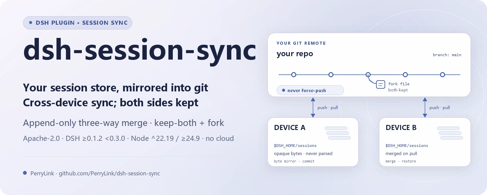
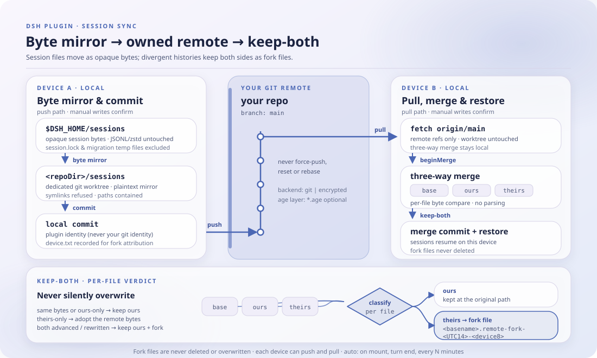

<div align="center">

<picture>
  <source media="(prefers-color-scheme: dark)" srcset="docs/assets/dsh-session-sync-hero-en-dark.webp">
  
</picture>

# dsh-session-sync

**Transforme seu armazenamento de sessões em um repositório git que você controla — sincronize entre dispositivos, mantenha os dois lados em qualquer conflito e nunca perca um turno.**

Um plugin de sincronização puramente host-side para DeepSeek Harness: os arquivos de sessão são copiados como bytes opacos, a divergência é resolvida por um merge de três vias append-only e o remoto é seu (git em texto plano por padrão, criptografia age opcional) — sem serviço na nuvem, sem armazenamento de terceiros.

[Instalar](#instalação-em-três-passos) · [Configuração](#configuração) · [FAQ](#faq) · [简体中文](README.md) · [English](README.en.md) · [Español](README.es.md) · [Português](README.pt.md) · [हिन्दी](README.hi.md)

[](LICENSE)
[](#compatibilidade)
[](https://www.npmjs.com/package/dsh-session-sync)
[](https://github.com/PerryLink/dsh-session-sync/actions/workflows/ci.yml)
[](#compatibilidade)

[](https://github.com/PerryLink/dsh-session-sync/stargazers)
[](https://www.npmjs.com/package/dsh-session-sync)
[](https://dshfind.com/plugins/PerryLink/dsh-session-sync?ref=badge)
[](https://securityscorecards.dev/viewer/?uri=github.com/PerryLink/dsh-session-sync)
[](https://dsh.market/)
[](https://gitee.com/perrylink/dsh-session-sync)

```sh
dsh plugin --profile <name> add dsh-session-sync
```

</div>

<sub>Plugin da comunidade, não afiliado à DeepSeek. Este é o único repositório oficial, mantido por PerryLink; repositórios com o mesmo nome em outras contas não são afiliados. O Gitee é um espelho.</sub>

## O que é

O `dsh-session-sync` espelha o armazenamento de sessões do DSH (`$DSH_HOME/sessions`) em um worktree git dedicado e o sincroniza com um remoto que **você** controla: sem serviço na nuvem, sem armazenamento de terceiros. Os arquivos de sessão são copiados como bytes opacos — o plugin nunca analisa JSONL/zstd, porque a codificação física pertence ao harness; o trabalho dele é mover esses bytes, mesclar históricos append-only e relatar o estado. Diante de qualquer divergência ele executa um merge de três vias append-only: **os dois lados são mantidos**, a versão remota é preservada como arquivos fork e nada é sobrescrito em silêncio. `backend: git` (o padrão) é um espelho em texto plano; `backend: encrypted` adiciona uma camada age por cima; todos os modos automáticos são configuráveis e reversíveis.

<p align="center">
  <picture>
    <source media="(prefers-color-scheme: dark)" srcset="docs/assets/dsh-session-sync-flow-v5-dark.svg">
    
  </picture>
</p>

## Instalação em três passos

1. **Instale** (escolha um canal):

   ```sh
   # canal git (último main; equivalente a git+https://github.com/PerryLink/dsh-session-sync.git)
   dsh plugin --profile web add github:PerryLink/dsh-session-sync
   # canal npm (versões publicadas)
   dsh plugin --profile web add dsh-session-sync
   # canal tarball: pnpm pack neste repo e depois
   dsh plugin --profile web add ./dsh-session-sync-<version>.tgz
   ```

   Sem etapa de build: `index.mjs` e `lib/` são os artefatos enviados.

2. **Configuração mínima** (aponte para um remoto git **privado** no seu profile patch):

   ```yaml
   - insert:
       - id: session-sync
         name: dsh-session-sync
         config:
           remote: git@github.com:you/your-dsh-sessions.git
   ```

3. **Verifique que ele monta**:

   ```sh
   dsh --profile web --dump-config | grep -A2 'id: session-sync'
   ```

   ```
   > /sync status
   > /sync pull
   > /sync push
   ```

**Desinstalar**: `dsh plugin --profile web remove dsh-session-sync` (ou remova a linha do profile patch).

## Capacidades principais

O `dsh-session-sync` transforma o armazenamento de sessões em um espelho git versionado no host e entrega a ação de sincronização ao seu remoto:

- **Comando `/sync`** — `status` (branch, remoto higienizado, à frente/atrás, arquivos sujos, arquivos fork), `diff`, `log`, `pull`, `push`, `help`.
- **Ferramentas `sync_status` / `sync_pull` / `sync_push`** — a mesma superfície para o modelo, dentro de um turno.
- **Resolução de conflitos append-only** — os registros de sessão são append-only; diante de qualquer divergência o plugin mantém **os dois** lados (a versão local é mantida, a remota é preservada como arquivos fork) e nunca sobrescreve em silêncio. Sessões divergentes também podem bifurcar no nível da sessão.
- **Modos automáticos** — pull ao iniciar, push após cada turno fechado e pull periódico, tudo configurável e reversível.
- **Escritas com porta de confirmação** — `pull`/`push` perguntam primeiro (via `userQuestions` ou `approval`); superfícies somente leitura nunca perguntam; sem respondedor a operação falha fechada.

```text
dispositivo A                         remoto (seu repositório git)            dispositivo B
$DSH_HOME/sessions ──espelho──▶ commit ──push──▶ [sessions] ──pull──▶ merge (manter ambos + fork)
```

### Comandos e ferramentas

| Superfície | Somente leitura | Requer confirmação | Notas |
|---|---|---|---|
| `/sync status` | ✅ | — | Branch, remoto higienizado, à frente/atrás, arquivos sujos, arquivos fork, último pull/push |
| `/sync diff` | ✅ | — | Alterações não commitadas + estatística `HEAD..remote` (somente leitura) |
| `/sync log` | ✅ | — | Últimos commits do repositório de sincronização |
| `/sync pull` | | ✅ | Fetch + merge com semântica de manter ambos; o local é mantido, o remoto é preservado como forks |
| `/sync push` | | ✅ | Espelho + commit + push; nunca força push, reconcilia e tenta de novo uma vez em caso de rejeição |
| `sync_status` | ✅ | — | Os mesmos fatos de `/sync status` para o modelo |
| `sync_pull` | | ✅ | Pull invocável pelo modelo |
| `sync_push` | | ✅ | Push invocável pelo modelo |

### Exemplos

Estes são os pontos de entrada reais do plugin; instale uma vez e chame um deles.

**Exemplo detalhado** — comando `/sync help`:

```text
sync: usage — /sync [status | pull | push | diff | log | help]
  status  show mirror state (default): branch, remote, ahead/behind, dirty, forks
  pull    fetch + merge remote changes (keep-both; confirms first)
  push    mirror + commit + push local changes (confirms first)
  diff    uncommitted changes + HEAD..remote stat (read-only)
  log     last commits in the sync repository
```

*Observed from `index.mjs:754-765 (registered /sync handler)`*

**Ramo de falha** — entrada `/sync push`:

```text
sync: cancelled: approval requires an open turn; /sync commands run between turns — mount userQuestions or set confirmVia: userQuestions
```

*Observed from `plugins/dsh-session-sync/lib/gate.mjs:134-137; plugins/dsh-session-sync/index.mjs:792-794; plugins/dsh-session-sync/test/gate.test.mjs:80-88; plugins/dsh-session-sync/README.md:246`*

**Exemplos curtos**: `/sync diff` · `/sync pull`

## Configuração

Todos os ajustes são campos `Config` do Schemastery (alteráveis a partir do cordis.yml). Uma sobreposição direcionada por id substitui a linha inteira — repita todas as chaves necessárias. O `cordis.patch.yml` documenta cada chave em linha.

Chaves mais usadas:

| Chave | Padrão | Significado |
|---|---|---|
| `remote` | `''` | Endereço do remoto (obrigatório antes de pull/push; status/diff funcionam sem ele) |
| `backend` | `git` | Backend de sincronização: `git` (espelho em texto plano) ou `encrypted` (conteúdo do espelho criptografado com age) |
| `sessionRoot` | `''` | Raiz do armazenamento de sessões; vazio = `$DSH_HOME/sessions` (faltando ambas, a carga falha) |
| `repoDir` | `''` | Raiz do worktree de sincronização; vazio = `$DSH_HOME/dsh-session-sync/repo` |
| `branch` | `main` | Nome do branch remoto |
| `autoPushOnTurnEnd` | `false` | Push após cada turno fechado |
| `pullIntervalMinutes` | `0` | Pull periódico a cada N minutos (`0` = desligado, máximo `10080`) |
| `cwdMap` | `[]` | Projeção de cwd na restauração `[{from, to}]` (o prefixo mais longo vence; cwds multiplataforma sem entrada ficam somente leitura em `<sessionRoot>/--unmapped--`) |
| `followSessionSymlinks` | `false` | Segue links simbólicos cujo realpath permanece dentro de `sessionRoot` (diagnóstico Android/proot) |
| `confirmVia` | `auto` | Canal de confirmação: `auto` (userQuestions primeiro, depois approval), `userQuestions`, `approval` |

<details>
<summary>Tabela de configuração completa (24 chaves)</summary>

| Chave | Padrão | Significado |
|---|---|---|
| `enabled` | `true` | Interruptor mestre; `false` desregistra o comando, as ferramentas, os listeners e os modos automáticos |
| `backend` | `git` | Backend de sincronização: `git` (espelho em texto plano) ou `encrypted` (conteúdo do espelho criptografado com age) |
| `sessionRoot` | `''` | Raiz do armazenamento de sessões; vazio = `$DSH_HOME/sessions` (faltando ambas, a carga falha) |
| `repoDir` | `''` | Raiz do worktree de sincronização; vazio = `$DSH_HOME/dsh-session-sync/repo` |
| `remote` | `''` | Endereço do remoto (obrigatório antes de pull/push; status/diff funcionam sem ele) |
| `branch` | `main` | Nome do branch remoto |
| `gitBin` | `git` | Caminho do executável git |
| `ageBin` | `age` | Caminho do executável age (sondado com `backend: encrypted`; se faltar, degrada para texto plano) |
| `ageRecipient` | `''` | Destinatário age (chave pública ou string de identidade); vazio = não consegue criptografar, degrada para texto plano |
| `ageIdentity` | `''` | Caminho de uma chave secreta age sem frase de senha para descriptografar; vazio = não consegue descriptografar, degrada para texto plano |
| `autoPullOnStart` | `false` | Pull uma vez ao montar o plugin (a configuração é a autorização; sem reconfirmação) |
| `autoPushOnTurnEnd` | `false` | Push após cada turno fechado |
| `durabilityTimeoutMs` | `2000` | Limite de espera pela barreira de durabilidade (`ctx.sessions.flush`) antes de um push automático — o writer JSONL do host agrupa eventos live por até 200 ms; no timeout, registra e faz push mesmo assim; `0` = não aguardar |
| `pullIntervalMinutes` | `0` | Pull periódico a cada N minutos (`0` = desligado, máximo `10080`) |
| `cwdMap` | `[]` | Projeção de cwd na restauração `[{from, to}]` (o prefixo mais longo vence; cwds multiplataforma sem entrada ficam somente leitura em `<sessionRoot>/--unmapped--`) |
| `followSessionSymlinks` | `false` | Segue links simbólicos cujo realpath permanece dentro de `sessionRoot` (diagnóstico Android/proot) |
| `confirmVia` | `auto` | Canal de confirmação: `auto` (userQuestions primeiro, depois approval), `userQuestions`, `approval` |
| `graceMs` | `10000` | Período de carência para matar o git (ms) |
| `commandTimeoutMs` | `120000` | Timeout por comando (ms) |
| `maxOutputBytes` | `262144` | Teto de saída coletada por fluxo (bytes) |
| `commitName` | `dsh-session-sync` | Nome do autor do commit |
| `commitEmail` | `dsh-session-sync@localhost` | E-mail do autor do commit |
| `registerCommand` | `true` | Registra o comando `/sync` |
| `registerTools` | `true` | Registra as ferramentas `sync_*` quando o serviço tools está presente |

</details>

Exemplo de sobreposição no seu profile patch:

```yaml
- insert:
    - id: session-sync
      name: dsh-session-sync
      config:
        remote: git@github.com:you/your-dsh-sessions.git
        branch: main
        autoPushOnTurnEnd: true
        pullIntervalMinutes: 30
        confirmVia: userQuestions
```

## FAQ

<details>
<summary>Onde os dados realmente ficam? Algo é enviado para a nuvem?</summary>

Não há serviço na nuvem nem armazenamento de terceiros. Duas cópias ficam na sua máquina: `$DSH_HOME/sessions` (o armazenamento de sessões do harness) e o worktree `repoDir` que você configurar (padrão `$DSH_HOME/dsh-session-sync/repo`); o remoto é **seu próprio** repositório git. `backend: encrypted` só transforma a cópia enviada/remota em texto cifrado age — o espelho local continua em texto plano.

</details>

<details>
<summary>Um conflito pode sobrescrever ou perder uma sessão?</summary>

Nada é sobrescrito em silêncio. Os registros de sessão são append-only e o merge de três vias mantém os dois lados diante de qualquer divergência: a versão local é mantida e a remota é preservada como arquivo fork chamado `<basename>.remote-fork-<carimbo UTC de 14 dígitos>-<device8>`; arquivos fork nunca são apagados nem sobrescritos, e o git nunca força push, reseta, faz rebase ou troca de branch. Uma sessão divergente também bifurca no nível da sessão, com um aviso persistente injetado na filha.

</details>

<details>
<summary>A criptografia vem ativada por padrão? O que acontece se o age faltar?</summary>

Não — o padrão é `backend: git`, então os bytes de sessão ficam sem criptografia no seu remoto: use um repositório privado. `backend: encrypted` precisa de `age` e de `ageRecipient`/`ageIdentity` não vazios; se faltar algo, o plugin avisa explicitamente e cai para git em texto plano — nunca finge criptografar. Verifique o aviso em `/sync status` antes de confiar no remoto como criptografado.

</details>

<details>
<summary>O que acontece sem git ou sem respondedor de confirmação?</summary>

Sem o executável `git` ou o serviço `subprocess`, as operações de sincronização falham com um motivo claro (os perfis continuam iniciando). O `/sync` roda entre turnos, onde o canal `approval` não tem um turno aberto ao qual se anexar: use `confirmVia: userQuestions`, ou conduza a sincronização pelas ferramentas `sync_*` dentro de um turno; sem nenhum respondedor a operação falha fechada.

</details>

<details>
<summary>Qual é a sobrecarga? Os modos automáticos rodam para sempre?</summary>

Os arquivos de sessão são copiados como bytes opacos e nunca analisados; cada comando git tem timeout, carência de término e teto de saída por fluxo. O push automático vem desligado, o pull periódico vem desligado (`pullIntervalMinutes: 0`) e o pull ao iniciar vem desligado — uma vez ativados, ficam cobertos pela autorização de configuração e não reconfirmam. O custo depende do tamanho do armazenamento de sessões e da latência do remoto; este repositório não tem dados de benchmark, então não damos números inventados.

</details>

## Limites de segurança

- **Nunca sobrescreve em silêncio.** O merge de três vias append-only mantém os dois lados diante de qualquer divergência, incluindo delete/modify (os bytes modificados são mantidos, a intenção de exclusão é respeitada); arquivos fork nunca são apagados e o git nunca força push, reseta, faz rebase ou troca de branch.
- **Contenção de caminhos.** Os arquivos são espelhados como bytes opacos com links simbólicos recusados e cada caminho unido é verificado por contenção (`PATH_UNSAFE` falha alto).
- **Saída higienizada.** Credenciais de URL remota, tokens e segredos `key=value` são redigidos antes de chegar ao modelo ou ao log; a exibição de caminhos recusa tudo fora da sua raiz.
- **Sem armazenamento de credenciais.** O plugin não armazena credenciais; as credenciais git ficam no seu helper de credenciais normal. As identidades/destinatários age são gerenciados por você, e as chaves nunca entram no repositório de sincronização.
- **Endurecimento do git.** O git roda com `GIT_TERMINAL_PROMPT=0` e `GIT_OPTIONAL_LOCKS=0`, limitado por prazo e sinal, com teto de saída por fluxo.
- **Falha fechada.** A falta de respondedor de confirmação, de remoto ou um caminho inseguro recusa a operação alto.

## Permissões e dados

- **Permissões**: operações que mudam estado cruzam a porta de confirmação (`confirmVia`); o plugin nunca reimplementa nem contorna os serviços `userQuestions`/`approval` do harness. Os modos automáticos são cobertos pela autorização de configuração e nunca reconfirmam.
- **Dados**: os metadados de sincronização (id do dispositivo, último pull/push, última cabeça de push, último erro) vivem no domínio de armazenamento `session-sync`. Os arquivos de sessão são copiados como bytes opacos — o plugin nunca os analisa. O id do dispositivo também é gravado em `device.txt` no repositório de sincronização para atribuição de forks entre dispositivos.
- **Log de sessão**: `sync/push`, `sync/pull` e `sync/conflict` são declarados em `types.d.ts`; só são anexados quando o host registra os tipos (ver Limitações conhecidas). Tudo o que é escrito ou exibido passa por higienização. A única mensagem durável que o plugin escreve — o aviso de fork por conflito — carrega o source kind próprio do plugin (producer-owned, `dsh-session-sync`); o harness aposentou o kind compartilhado `plugin` e o recusa ao reler uma sessão.

## Criptografia e modelo de ameaças

`backend: encrypted` adiciona uma camada **age** opcional sobre o espelho: os bytes de sessão são criptografados em arquivos `encrypted/**/*.age` antes de serem commitados e enviados, e descriptografados de volta ao espelho local em texto plano antes da mesclagem. O merge de três vias sempre roda em texto plano localmente, então a semântica append-only de manter ambos não muda.

O que a criptografia **protege**:

- **O conteúdo do espelho em repouso no remoto.** Os arquivos de sessão que você envia são texto cifrado age; o host remoto, seus operadores e qualquer pessoa que clone o repositório não veem os bytes de sessão em claro sem a chave privada.

O que ela **não** protege (a fronteira):

- **As chaves e identidades age são suas.** Os arquivos de destinatário/identidade nunca são distribuídos, armazenados ou rotacionados pelo plugin. Se uma chave vazar, o conteúdo do espelho que ela protege fica exposto. Use uma identidade sem frase de senha e mantenha-a fora do repositório.
- **O remoto continua sendo, na prática, um repositório privado.** Metadados do git — mensagens de commit, o `.gitignore`, a estrutura de caminhos `encrypted/`, nomes de branch e a atividade de push/fetch — continuam visíveis para o host remoto. A criptografia esconde o *conteúdo*, não o fato de você sincronizar, nem a forma da sua árvore de sessões.
- **O texto plano ainda existe localmente.** O espelho em `<repoDir>/sessions/` é texto plano no disco; a criptografia protege a cópia transmitida/remota, não a criptografia do disco local nem o armazenamento de sessões em uso.
- **Degradação graciosa significa texto plano.** Com `backend: encrypted`, se o `age` faltar, ou `ageRecipient`/`ageIdentity` estiverem vazios, o plugin cai para o caminho git em texto plano **e avisa explicitamente** no status/log — nunca finge criptografar. Verifique o aviso em `/sync status` antes de confiar no remoto como criptografado.

Linha de base: com `backend: git` (o padrão), os bytes de sessão são armazenados sem criptografia no **seu** remoto git — use um repositório privado.

### Sessões multiplataforma e projeção de cwd

Uma sessão do Windows sincronizada no Linux (ou o contrário) carrega um `header.cwd` que não é um caminho absoluto nativo no host receptor: o `dsh-workspace` indexa sessões via `realpath(header.cwd)`, e o `session-persistence-jsonl` nem consegue analisar um header cujo cwd não seja absoluto nativo. Mapeie o prefixo de origem para um caminho local:

```yaml
cwdMap:
  - from: 'C:\Users\me'
    to: /home/me/win
```

- O prefixo mais longo vence, e os prefixos terminam num limite de segmento (`C:\Users\me2` não corresponde a `C:\Users\me`).
- A restauração projeta apenas a **cópia local**: o primeiro frame leva o cwd local e cai no diretório de projeto do host, então a sessão aparece na lista de workspaces. O espelho mantém os bytes do dispositivo de origem; um push reanexa o frame de cabeçalho original, então o outro dispositivo continua vendo appends idênticos byte a byte e nunca recebe conflitos sem sentido.
- Um cwd multiplataforma sem entrada vai para `<sessionRoot>/--unmapped--`: **visível mas somente leitura** (`sync_status` o informa como `cwdUnmapped`, e edições locais nunca são enviadas). Adicione uma entrada `cwdMap` e faça pull de novo para torná-lo uma sessão local continuável.

### Links simbólicos (Android/proot)

O espelho **nunca segue links simbólicos** por padrão (limite de segurança). O `link2symlink` do Android/proot informa os arquivos de sessão escritos pelo host como links simbólicos (`readdir` diz link, `readlink` está vazio, os bytes são legíveis), então as sessões do próprio telefone nunca chegam ao espelho. Diagnóstico e seguimento opcional:

- `sync_status` informa `skippedSymlinks` / `skippedSymlinkPaths` (contagem e amostras de caminhos) e `followedSymlinks`; o resultado do push leva o mesmo aviso.
- `followSessionSymlinks: true` (padrão `false`) segue apenas links cujo `realpath` permanece dentro de `sessionRoot`; links que escapam são sempre ignorados e contados.

## Limitações conhecidas

- **A criptografia é opcional e o age é uma dependência externa.** `backend: encrypted` adiciona uma camada age (ver «Criptografia e modelo de ameaças» acima); se o `age` faltar ou `ageRecipient`/`ageIdentity` estiverem vazios, avisa explicitamente e cai para texto plano, e uma identidade protegida por frase de senha não pode ser usada (a descriptografia bloquearia num prompt TTY, então falha fechada). Com `backend: git` (o padrão), os bytes de sessão são armazenados sem criptografia no **seu** remoto git — use um repositório privado.
- **`object-storage` é uma interface reservada.** É um marcador de posição de interface e falha alto ao carregar; só `git` e `encrypted` estão implementados.
- **Requer git.** O plugin precisa do executável `git` e do serviço `subprocess`; sem eles, as operações de sincronização falham com um motivo claro (os perfis continuam iniciando).
- **Um `repoDir` por backend.** Trocar entre `git` e `encrypted` no mesmo `repoDir` não é suportado; use um worktree novo por backend.
- **Eventos de sessão em `0.1.0-rc.6`/`0.1.0-rc.8`/`0.1.1-rc.2`/`0.1.2-alpha.2`/`0.1.2-alpha.3`/`0.1.2-rc.1`/`0.1.7-alpha.2`.** O harness não registra os tipos `sync/*`, então os anexos ao log de sessão são pulados (as sessões continuam carregando); o plugin os habilita automaticamente quando um host registra os tipos ou expõe o envelope `ignorable` em `Session.append`.
- **`approval` entre turnos.** O `/sync` roda entre turnos, onde o canal `approval` não tem um turno aberto ao qual se anexar; use `confirmVia: userQuestions` para sincronização por comando, ou conduza a sincronização pelas ferramentas dentro de um turno. A verificação de turno aberto lê a projeção de sessão `turnBoundary` do host: uma composição sem `@deepseek-ai/dsh-session-projection` não consegue verificar o estado do turno e falha fechada com esse motivo.
- **Artefatos privados do host não são sincronizados.** `session.lock` (o lease de sessão do harness) e os arquivos de staging `session.migration.*.tmp` nunca são espelhados nem apagados: são estado de execução, não conteúdo sincronizável. Os logs de sessão (`session.jsonl`, `session.v[1-9]*.jsonl[.zstd]`) continuam sendo a carga útil espelhada.

## Compatibilidade

| Superfície | Estado |
|---|---|
| Harness | DeepSeek Harness `dsh-v0.2.1-alpha.1` (tag do GitHub, verificado em 2026-09-25: cadeia completa de portas contra os peers fixados `0.1.7-rc.2`). Linha de dependência npm `0.1.7-rc.2`, peers `>=0.1.2-rc.1 <0.2.0 \|\| >=0.1.5-alpha.1 <0.2.0 \|\| >=0.1.6-0 <0.2.0 \|\| >=0.1.7-0 <0.2.0`. (adaptado em 2026-10-04): o aviso de fork por conflito carrega o source kind próprio do plugin (producer-owned) — o harness aposentou o kind compartilhado `plugin` e o recusa ao reler. |
| Node | `^22.19.0 \|\| >=24.9.0` |
| Plataformas | Onde quer que `git` e DSH rodem (espelho baseado em git; sem código específico de plataforma) |
| Modelo | Modelos apenas de texto totalmente suportados; nenhuma visão ou capacidade extra de modelo é necessária |

## Ecossistema e qualidade

- [Espelho no Gitee](https://gitee.com/perrylink/dsh-session-sync) (espelho sincronizado; o GitHub é canônico)
- [Página do dshfind](https://dshfind.com/plugins/PerryLink/dsh-session-sync) (instalações e ranking)
- [Relatório do OpenSSF Scorecard](https://securityscorecards.dev/viewer/?uri=github.com/PerryLink/dsh-session-sync) (movido por [.github/workflows/scorecard.yml](.github/workflows/scorecard.yml))
- [Relatório de verificação do dsh-plugin-doctor](https://github.com/PerryLink/dsh-plugin-doctor#verified-徽章) (selo histórico de verificação K10–K13)
- [DSH Market](https://dsh.market/) (listado)
- **Canal da loja 1024**: rode `npm i -g dsh1024` uma vez e depois `dsh1024 plugin --profile web add dsh-session-sync` (conta para o ranking de instalações do [deepseek1024.com](https://deepseek1024.com))
- [Base de conhecimento do ecossistema](https://perrylink.github.io/dsh-plugin-guide/): guia de desenvolvimento de plugins · dados medidos de seleção · critérios de manutenção

## Desenvolvimento

```sh
pnpm install                                       # node ^22.19 || >=24.9
pnpm run typecheck && pnpm run typecheck:ci        # tsc --checkJs: face do checkout + face da linha publicada
pnpm test                                          # node --test (14 arquivos de teste; a suíte git do motor é pulada sem git)
pnpm run verify:self-contained                     # as specs de dependências resolvem a partir do registry
pnpm run verify:artifacts                          # arquivos enviados presentes + index.mjs importável
pnpm run check:readmes                             # consistência dos README em cinco idiomas
pnpm pack                                          # o tarball publicado
```

Sem etapa de build: ESM puro, `index.mjs` e `lib/` são os artefatos enviados. As imagens do README são geradas programaticamente por [`scripts/gen-readme-assets.py`](scripts/gen-readme-assets.py) (Python + Pillow) e podem ser reexecutadas com segurança.

Topics: `dsh`, `dsh-plugin`, `deepseek-harness`, `deepseek`, `cordis`, `session-sync`, `session`, `git`, `sync`, `cross-device`

## Família e agradecimentos

Este projeto faz parte da família de plugins de DeepSeek Harness da [PerryLink](https://github.com/PerryLink) (todos Apache-2.0). Se ele for útil, **uma estrela ajuda a próxima pessoa a encontrá-lo** — nada fica bloqueado atrás dela.

- [@BlakrPander](https://github.com/BlakrPander) — redação de PAT-como-usuário e a análise delete/modify de manter ambos (#14); as duas partes saíram em 0.2.27/0.2.28.
- [@PerryLink](https://github.com/PerryLink) — criador e mantenedor: motor de espelho git, merge append-only de manter ambos, comando `/sync` e ferramentas `sync_*`, modos automáticos, higienizadores e a documentação em cinco idiomas.

<details>
<summary>Expandir todos os plugins</summary>

| Plugin | Estado |
|---|---|
| **[dsh-aqua-input-check](https://github.com/PerryLink/dsh-aqua-input-check)** |  |
| **[dsh-archive-check](https://github.com/PerryLink/dsh-archive-check)** |  |
| **[dsh-auto-review](https://github.com/PerryLink/dsh-auto-review)** |  |
| **[dsh-autotier](https://github.com/PerryLink/dsh-autotier)** | 🧊 CONGELADO — ver o README do repo |
| **[dsh-bid-ca-precheck](https://github.com/PerryLink/dsh-bid-ca-precheck)** |  |
| **[dsh-bid-qual-check](https://github.com/PerryLink/dsh-bid-qual-check)** |  |
| **[dsh-cert-mcp](https://github.com/PerryLink/dsh-cert-mcp)** | 🧊 CONGELADO — ver o README do repo |
| **[dsh-checkpoint-rewind](https://github.com/PerryLink/dsh-checkpoint-rewind)** |  |
| **[dsh-click](https://github.com/PerryLink/dsh-click)** |  |
| **[dsh-composer-history](https://github.com/PerryLink/dsh-composer-history)** |  |
| **[dsh-contract-stance](https://github.com/PerryLink/dsh-contract-stance)** |  |
| **[dsh-customs-doc-check](https://github.com/PerryLink/dsh-customs-doc-check)** |  |
| **[dsh-data-quality](https://github.com/PerryLink/dsh-data-quality)** | 🧊 CONGELADO — ver o README do repo |
| **[dsh-demurrage-ledger](https://github.com/PerryLink/dsh-demurrage-ledger)** |  |
| **[dsh-doublecheck](https://github.com/PerryLink/dsh-doublecheck)** |  |
| **[dsh-drill-script-check](https://github.com/PerryLink/dsh-drill-script-check)** |  |
| **[dsh-eia-guide-check](https://github.com/PerryLink/dsh-eia-guide-check)** |  |
| **[dsh-emergency-plan](https://github.com/PerryLink/dsh-emergency-plan)** |  |
| **[dsh-essay-rubric-check](https://github.com/PerryLink/dsh-essay-rubric-check)** |  |
| **[dsh-evidence-check](https://github.com/PerryLink/dsh-evidence-check)** |  |
| **[dsh-export-ctl-check](https://github.com/PerryLink/dsh-export-ctl-check)** |  |
| **[dsh-fast](https://github.com/PerryLink/dsh-fast)** |  |
| **[dsh-fmea-table-check](https://github.com/PerryLink/dsh-fmea-table-check)** |  |
| **[dsh-forecast-penalty](https://github.com/PerryLink/dsh-forecast-penalty)** |  |
| **[dsh-fund-research](https://github.com/PerryLink/dsh-fund-research)** |  |
| **[dsh-github](https://github.com/PerryLink/dsh-github)** |  |
| **[dsh-gongwen-flow-check](https://github.com/PerryLink/dsh-gongwen-flow-check)** |  |
| **[dsh-gongwen-word-check](https://github.com/PerryLink/dsh-gongwen-word-check)** |  |
| **[dsh-guard-plan-qc](https://github.com/PerryLink/dsh-guard-plan-qc)** |  |
| **[dsh-hazchem-check](https://github.com/PerryLink/dsh-hazchem-check)** |  |
| **[dsh-hazplan-check](https://github.com/PerryLink/dsh-hazplan-check)** |  |
| **[dsh-hidden-risk-map](https://github.com/PerryLink/dsh-hidden-risk-map)** |  |
| **[dsh-hs-classify](https://github.com/PerryLink/dsh-hs-classify)** |  |
| **[dsh-icd-rule-check](https://github.com/PerryLink/dsh-icd-rule-check)** |  |
| **[dsh-industry-research](https://github.com/PerryLink/dsh-industry-research)** |  |
| **[dsh-lawcite-adapter](https://github.com/PerryLink/dsh-lawcite-adapter)** |  |
| **[dsh-laya](https://github.com/PerryLink/dsh-laya)** |  |
| **[dsh-lc-doc-check](https://github.com/PerryLink/dsh-lc-doc-check)** |  |
| **[dsh-learning-gap-check](https://github.com/PerryLink/dsh-learning-gap-check)** |  |
| **[dsh-library](https://github.com/PerryLink/dsh-library)** |  |
| **[dsh-local-ai](https://github.com/PerryLink/dsh-local-ai)** |  |
| **[dsh-lsp-actions](https://github.com/PerryLink/dsh-lsp-actions)** |  |
| **[dsh-mask](https://github.com/PerryLink/dsh-mask)** |  |
| **[dsh-mcp-panel](https://github.com/PerryLink/dsh-mcp-panel)** |  |
| **[dsh-medrec-qc](https://github.com/PerryLink/dsh-medrec-qc)** |  |
| **[dsh-memento](https://github.com/PerryLink/dsh-memento)** | 🧊 CONGELADO — ver o README do repo |
| **[dsh-nsfc-form-check](https://github.com/PerryLink/dsh-nsfc-form-check)** |  |
| **[dsh-nurse-record-check](https://github.com/PerryLink/dsh-nurse-record-check)** |  |
| **[dsh-observe](https://github.com/PerryLink/dsh-observe)** |  |
| **[dsh-origin-rvc-check](https://github.com/PerryLink/dsh-origin-rvc-check)** |  |
| **[dsh-ota-review-check](https://github.com/PerryLink/dsh-ota-review-check)** |  |
| **[dsh-output-styles](https://github.com/PerryLink/dsh-output-styles)** |  |
| **[dsh-paper-doc-adapter](https://github.com/PerryLink/dsh-paper-doc-adapter)** |  |
| **[dsh-permission-rules](https://github.com/PerryLink/dsh-permission-rules)** |  |
| **[dsh-permit-report-check](https://github.com/PerryLink/dsh-permit-report-check)** |  |
| **[dsh-pipeline-check](https://github.com/PerryLink/dsh-pipeline-check)** |  |
| **[dsh-pleading-draft](https://github.com/PerryLink/dsh-pleading-draft)** |  |
| **[dsh-plugin-doctor](https://github.com/PerryLink/dsh-plugin-doctor)** | 🚫 APOSENTADO (repo arquivado) |
| **[dsh-plugin-guide](https://github.com/PerryLink/dsh-plugin-guide)** |  |
| **[dsh-plugin-kit](https://github.com/PerryLink/dsh-plugin-kit)** | 🚫 APOSENTADO (repo arquivado) |
| **[dsh-plugin-upgrade](https://github.com/PerryLink/dsh-plugin-upgrade)** | 🚫 APOSENTADO (repo arquivado) |
| **[dsh-policy-brief-draft](https://github.com/PerryLink/dsh-policy-brief-draft)** |  |
| **[dsh-power-loss-split](https://github.com/PerryLink/dsh-power-loss-split)** |  |
| **[dsh-power-ticket-check](https://github.com/PerryLink/dsh-power-ticket-check)** |  |
| **[dsh-ppap-check](https://github.com/PerryLink/dsh-ppap-check)** |  |
| **[dsh-protest-deadline](https://github.com/PerryLink/dsh-protest-deadline)** |  |
| **[dsh-railway-window](https://github.com/PerryLink/dsh-railway-window)** |  |
| **[dsh-repair-order-qc](https://github.com/PerryLink/dsh-repair-order-qc)** |  |
| **[dsh-research-report](https://github.com/PerryLink/dsh-research-report)** |  |
| **[dsh-review-reply-check](https://github.com/PerryLink/dsh-review-reply-check)** |  |
| **[dsh-rulefile-check](https://github.com/PerryLink/dsh-rulefile-check)** |  |
| **[dsh-safety-brief-check](https://github.com/PerryLink/dsh-safety-brief-check)** |  |
| **[dsh-score](https://github.com/PerryLink/dsh-score)** | 🧊 CONGELADO — ver o README do repo |
| **[dsh-session-sync](https://github.com/PerryLink/dsh-session-sync)** |  |
| **[dsh-site-log-check](https://github.com/PerryLink/dsh-site-log-check)** |  |
| **[dsh-skill-pack-security](https://github.com/PerryLink/dsh-skill-pack-security)** |  |
| **[dsh-soe-decision-check](https://github.com/PerryLink/dsh-soe-decision-check)** |  |
| **[dsh-soilwater-check](https://github.com/PerryLink/dsh-soilwater-check)** |  |
| **[dsh-sop-sync-check](https://github.com/PerryLink/dsh-sop-sync-check)** |  |
| **[dsh-spc-gbt-adapter](https://github.com/PerryLink/dsh-spc-gbt-adapter)** |  |
| **[dsh-talk](https://github.com/PerryLink/dsh-talk)** |  |
| **[dsh-tender-extract](https://github.com/PerryLink/dsh-tender-extract)** |  |
| **[dsh-tender-matrix](https://github.com/PerryLink/dsh-tender-matrix)** |  |
| **[dsh-test-drive](https://github.com/PerryLink/dsh-test-drive)** |  |
| **[dsh-ticktick](https://github.com/PerryLink/dsh-ticktick)** | 🚫 APOSENTADO (repo arquivado) |
| **[dsh-translate](https://github.com/PerryLink/dsh-translate)** |  |
| **[dsh-warranty-calc](https://github.com/PerryLink/dsh-warranty-calc)** |  |
| **[dsh-budget](https://github.com/PerryLink/dsh-budget)** | 🧊 CONGELADO — ver o README do repo |
| **[dsh-claude-move](https://github.com/PerryLink/dsh-claude-move)** | 🧊 CONGELADO — ver o README do repo |
| **[dsh-defend](https://github.com/PerryLink/dsh-defend)** | 🧊 CONGELADO — ver o README do repo |
| **[dsh-draw](https://github.com/PerryLink/dsh-draw)** | 🧊 CONGELADO — ver o README do repo |
| **[dsh-reach](https://github.com/PerryLink/dsh-reach)** | 🧊 CONGELADO — ver o README do repo |
| **[dsh-background-agents](https://github.com/PerryLink/dsh-background-agents)** | 🚫 APOSENTADO (repo arquivado) |
| **[dsh-session-pin](https://github.com/PerryLink/dsh-session-pin)** | 🚫 APOSENTADO (repo arquivado) |
| **[dsh-team-rooms](https://github.com/PerryLink/dsh-team-rooms)** | 🚫 APOSENTADO (repo arquivado) |

</details>

## Licença

[LICENSE](LICENSE) (Apache License 2.0) © 2026 dsh-session-sync contributors

<p align="center"><sub>Apache-2.0 · Plugin da comunidade, não afiliado à DeepSeek.</sub></p>
